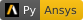

= Keras Importer to Scade One
by SwaNN Team (Yingying H., Yiming C., Guilherme G., Tim P., Jeff T.)
:description: Readme for Keras Importer to Swan🦢
:icons: font
:toc: left
:sectnums:
:favicon: static/favicon.png
:stylesheet: static/asciidoctor-ansys.css


:source-highlighter: pygments
:pygments-style: manni

:main_py: src/s1_keras_importer.py
:app: src/app_keras_importer.py
:install: install.bat



image:https://img.shields.io/badge/code%20style-black-000000.svg?style=flat[Black, link=https://github.com/psf/black]


== 🦢 Purpose of the Project

Neural Networks are getting increasingly presents in our lives.

However, a challenge remain for using them safely in a Safety-Critical Environment like
autonomous vehicles, planes, etc.

Our project aims to help filling this gap by providing an importer of Keras Model
(a popular Neural Network Library developped in Python)
to Ansys Scade One (a world-leading software for designing Safety-Critical applications).

To do so, we are first transforming the Keras Model to a Graph (using module `networkx`),
and then using Scade One API (part of pyAnsys) to create our Scade One Model.

NOTE: This is actually a porting to Scade One of the old SCADE Neural Network package
(available https://catalog.ansys.com/product/620eb1f7475fc9e881614971/neural-networks-pa[here]).


== 🚀 Getting Started

=== Installation

You need *Python version 3.9 - 3.12*.

To install all the dependencies, launch the batch file: *{install}* in root folder.

=== Creating a Virtual Environment

NOTE: This step is not mandatory: use it if you want to
avoid conflict of dependencies with other projects +
or if you are using a Python distribution provided in other installed tools.

If you want to preserve your existing Python Environment,
you can create a Virtual environment *before* lauching the script by doing as follows:

1. Open a command line
2. Go to the installation folder of Keras Importer
3. Launch command `python -m venv .venv`
4. Launch the installer `{install}`

This also works if you are using a Python provided with the installation
of another tool (e.g. Ansys SCADE).
In this case, use the full path of Python in double quotes:
`"<path to python.exe>" -m venv .venv`

=== Checking Installation

If no error was reported while running *{install}*, then the installation is successful🎉.

You can now move to the next step: importing a model.

== 🧠Importing Models from Keras

There are multiple ways to use our tool:

* An importer script to perform the import in a command line: *{main_py}*
* Web-based UI to visualize the NN and invoke the importer script: *{app}*
* Loading the modules from your own Python script or from a Jupyter Notebook

NOTE: To save a model in Keras, you can just do the following in Python: `model.save("path-to-file.h5")`,
assuming `model` is your Keras Model developped in Python.


=== Running command line script

The command line will import a model saved in a *.h5* format.

An example of command line to import an Example provided for Lenet is:
```
python src\{main_py} "Examples/lenet/trained_lenet.h5" -o "imported_model" --copy-keras
```

NOTE: Option "--copy-keras" will copy the keras lib to create a standalone project

TIP: You can see all available options with command: `python src\{main_py} --help`

=== Using Keras-Importer Python Library

You need to do the following:

```python
from s1_keras_importer import import_keras_in_s1  # import the importing function

# 1. Create your model
model = ... # either a Path of a saved model or a Model object created with Keras

# ... optionally, set a single test input to check your model
input_test = [...]  # it is a list for the case where the model has several inputs

# 2. Specify the Output Dir
output_dir = ... # your output directory

# 3. Launch the import
# ... if you DON'T have test input
import_keras_in_s1(model, output_dir)
# ... if you HAVE some test input
import_keras_in_s1(model, output_dir, tests_inputs=inputs_test)

```

An example is provided in the file `example_import_lenet_to_s1.py` (in folder *src*):
You can just run it with:

```
python src\example_import_lenet_to_s1.py
```


=== Launch the Web-Based App

For more convenience (in particular for users not familiar with command line),
we have provided a Web App to import a .h5 file and generate a Scade One Model.

It also provides a visualization of the Model and Graph,
as well as provides the example of Lenet with data from MNIST.

To launch, just double click on the file *{app}* in folder *src*.


== Compatibility with Keras

=== Supported Layers

* Dense (maximum 2 dimensions)
* MaxPool2D
* Flatten
* Conv2D
* Dropout
* Activation (ReLU, Sigmoid, Tanh, Softmax)
* Add
* ZeroPadding2D
* BatchNormalization

=== Known Limitations

Nested models (i.e. a model inside the model) are not supported yet.

