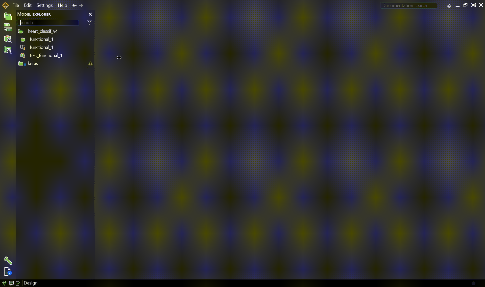
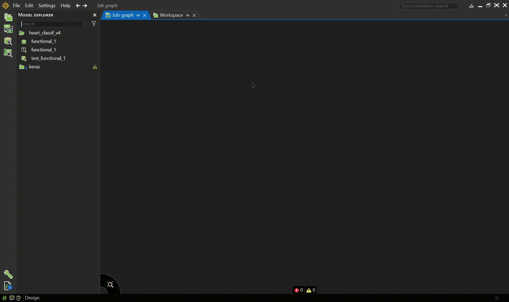

<span id="_Toc242962054" class="anchor"></span>**Laboratory 1 — Introduction to AI Methods for Embedded Systems (Using Keras)**


# 1. Laboratory Overview

Artificial Intelligence methods are increasingly used for tasks that are difficult to solve using explicitly programmed rules. Examples include sensor interpretation, anomaly detection, image recognition, audio classification, predictive maintenance, and medical signal analysis. Such tasks, especially those who need to be performed in real time, cannot often be deployed on a general purpose computer having all the resources in the world available. These need to be deployed as embedded systems which have limited processing power, memory, storage and sometimes even limited battery life.

In this laboratory, students are introduced to neural-network development using **Keras with the TensorFlow framework used as backend**. No previous experience with TensorFlow, Keras, PyTorch, or other machine-learning frameworks is required.

The laboratory follows a progressive approach. Students first become familiar with the Keras programming model and train a small neural network for a regression problem related to sensor calibration. They then move to a more realistic embedded-AI application inspired from the functionality of a digital stethoscope: the detection of heart murmurs from heart sounds recordings.

The second part introduces Convolutional Neural Networks (CNNs) from first principles. Heart sound recordings are transformed into time-frequency representations that can be processed by a two-dimensional CNN.

The emphasis of the laboratory is not only on obtaining a working neural network, but also on understanding the complete development workflow:

**data → preprocessing → model architecture → training → evaluation → experimentation → embedded-system considerations**

Estimated completion time: **approximately 4 hours**.

# 2. Learning Objectives

After completing this laboratory, the student should be able to:

- explain the difference between regression and classification;

- understand what samples, features, targets, training data, validation data, and test data are;

- create and configure a Python environment containing TensorFlow and Keras;

- construct a basic neural network using the Keras Sequential API;

- understand what input, hidden, and output layers are;

- train a neural network using the model.fit() Keras method;

- explain the roles of a loss function, activation function, optimizer, metric, epoch, and batch;

- evaluate a regression model using Mean Absolute Error and Mean Squared Error;

- distinguish between training performance and validation performance;

- understand the basic operating principle of a convolutional layer;

- design the architecture of a simple CNN for binary classification;

- interpret a confusion matrix and basic classification metrics;

- recognize overfitting and underfitting;

- experiment with basic neural-network hyperparameters;

- discuss why model size, preprocessing complexity, memory usage, and inference cost are relevant for embedded AI.

# 3. Prerequisites

Students are expected to have:

- basic programming knowledge;

- basic Python syntax;

- familiarity with variables, functions, lists, arrays, loops, and conditional statements;

- basic understanding of mathematical functions.

Previous knowledge of neural networks is useful but not required.

The recorded lecture and the materials associated with it introduce the fundamental concepts required for understanding neural networks. Students interested in a deeper mathematical understanding are encouraged to also consult the additional references provided in both the lecture and in this lab.

Additional Resources :

- Melanie Mitchell - Artificial Intelligence. A guide for thinking humans

- Dive into deep learning - [<u>https://d2l.ai/index.html</u>](https://d2l.ai/index.html)

- Andrej Karpathy’s Youtube playlist Neural Networks : Zero to Hero - [<u>https://karpathy.ai/zero-to-hero.html</u>](https://karpathy.ai/zero-to-hero.html)

- The Independent Code Youtube Channel

  - Neural Network from Scratch (<https://youtu.be/pauPCy_s0Ok?si=CSDVU3Jg15860R8g>)

  - Convolutional Neural Network from Scratch (<https://youtu.be/Lakz2MoHy6o?si=70x6Wah5mLLMzwuj>)

- Harper Carroll’s 10 days of AI basics (short form) (<https://youtube.com/playlist?list=PL-ocKywdn6lHkia9UoSY709h6AG2jWKKM&si=chSDcFbPPBJPwCuc>)

- Harper Carroll’s 10 days of AI basics (long form) : (<https://youtube.com/playlist?list=PL-ocKywdn6lE9l4LIPL4gMY4nNRfjEswG&si=quZbfKk1uJl45nNO>)

- DeepBean Youtube channel : Optimization for Deep Learning (Momentum, RMSprop, AdaGrad, Adam) : (<https://youtu.be/NE88eqLngkg?si=NsO5rp3Yhho1EHCE>)

# 5. Environment Setup

## 5.1 Creating a Python virtual environment

Using a dedicated virtual environment prevents dependencies installed for this laboratory from interfering with other Python projects.

Create a new directory for the laboratory and open a terminal inside it.

Create the environment:

``` bash
python -m venv .venv
```

On Windows PowerShell:

``` powershell
.venv\Scripts\Activate.ps1
```

On Linux or macOS:

``` bash
source .venv/bin/activate
```

❗️Be careful what Python version you use and which are the compatible Python versions with Tensorflow. While writing this lab the latest version of tensorflow is 2.21.0 which was launched in March 2026 and the only allowed Python versions are 3.9 – 3.13. You can check the Python version support and other system requirements on the page <https://www.tensorflow.org/install> (accessed in October 2026).

Upgrade pip:

``` bash
python -m pip install --upgrade pip
```

Install the packages required throughout the laboratory:

``` bash
pip install tensorflow keras numpy matplotlib pandas scikit-learn librosa soundfile jupyter ansys-scadeone-core seaborn
```

Keras 3 can operate with several computational backends, including TensorFlow, JAX, and PyTorch. In this course, **TensorFlow will be used as the Keras backend** in order to maintain a common environment for all exercises. Current Keras documentation describes Keras as a multi-backend framework and allows TensorFlow to be selected explicitly.

## 5.2 Starting Jupyter

You can either open a jupyter notebook in the standalone web interface or within an intergrated development environment (IDE).

**Using Jupyter Notebook interface :**

Open a terminal inside the virtual environment.

Start Jupyter Notebook with:

``` bash
jupyter notebook
```

A window as the one below illustrating a file hierarchy will be shown :


Create a new Python notebook called:

``` text
lab01_keras_introduction.ipynb
```

Open the notebook. The jupyter notebook is made out of cells. Choose between a code or a markdown cell from the dropdown menu highlighted in the image below :


**Using the jupyter notebook extension of the IDE (Visual Studio Code in this case) :**


Open the folder where the virtual environment was saved.

Create a new Python notebook called:

``` text
lab01_keras_introduction.ipynb
```

Open the notebook .ipynb file.

Select the virtual environment as the jupyter notebook kernel like in the video below.


The notebook is made out of cells. You can select the programming language the contents of a cell need to be interpreted as by clicking on the option on the bottom right corner and by selecting.


All exercises in this laboratory can be completed inside this notebook excepting the one which uses SCADE One.

# 

# 6. Importing the Required Libraries

The Keras backend must be selected before importing Keras.

``` python
import os
os.environ["KERAS_BACKEND"] = "tensorflow"
import keras
from keras import layers
import tensorflow as tf
import numpy as np
import matplotlib.pyplot as plt
import pandas as pd
import shutil
import random
import sys
import ctypes
import threading
from sklearn.metrics import (
    accuracy_score, confusion_matrix, classification_report,
    ConfusionMatrixDisplay,
)
from sklearn.model_selection import train_test_split
from pathlib import Path
import seaborn as sns
from ansys.scadeone.core import ScadeOne
from ansys.scadeone.core.svc.pywrapper.python_wrapper import PythonWrapper
```

For reproducibility, initialize the random number generators:

``` python
keras.utils.set_random_seed(42)
```

Display the installed versions:

``` python
print("Keras version:", keras.__version__)
print("TensorFlow version:", tf.__version__)
```

Inspect the computational devices detected by TensorFlow:

``` python
print(tf.config.list_physical_devices())
```

A GPU is not required for the simple models developed in this laboratory. CPU execution is sufficient.

# 7. Keras Basics

## 7.1 What is Keras?

Keras is a high-level API for constructing and training neural networks. Rather than manually implementing operations such as gradient calculation and weight updates, developers describe the architecture of the neural network and configure how it should be trained.

A neural network in Keras is composed of **layers**.

For simple architectures in which the output of one layer becomes the input of the next layer, Keras provides the Sequential model. The official Keras documentation describes Sequential as appropriate for a plain stack of layers with one input tensor and one output tensor per layer.

The output values of a neural network are called **predictions. Prediction** is usually prefered instead of **forecast.** Forecasts are predictions of future events. The process of running a neural network in called **inference**.

**Deep learning** is an umbrella term used frequently in discussions about AI. It actually refers to a neural network whose weights are optimized using machine learning and has at least 2 hidden layers. A **hidded layer** is a layer which is neither the input layer, nor the output layer.

Consider the following small network:

``` python
model = keras.Sequential([
    keras.Input(shape=(3,)),
    layers.Dense(8, activation="relu"),
    layers.Dense(1)
])
```

Run the following commpand afterwards and analyse its output :

``` python
model.summary()
```

The model receives three numerical values as its input.

The first Dense layer contains eight artificial neurons. Each neuron computes a weighted combination of its inputs and subsequently applies the ReLU activation function.

The final layer takes the input given by the previous dense layer and its only neuron produces one numerical value which is the output of the whole neural network.

**Proposed Exercises :**

Inspect the output generated by:

``` python
model.summary()
```

Answer the following questions:

1.  What is the input dimension of the model?  
    A : The input dimension is (3,) which represents a one-dimensional tensor containing three zero dimensional vectors. (scalars).

2.  How many neurons are present in the hidden layer?  
    A : 8 neurons

3.  How many outputs does the model produce?  
    A : It only produces one output.

4.  How many trainable parameters does each layer contain?  
    A : The first dense layer produces 32 trainable parameters while the second and final dense layer produces 9 trainable parameters.

5.  Why does the first dense layer have 32 trainable parameters if the input is only built from 3 scalars and the layer itself has only 8 neurons?  
    A : Each neuron computes ReLU(w1\*x1 + w2\*x2 + w3\*x3 + b), where w1/2/3 are the weights, x1/2/3 are the input scalars and b is the bias of a particular neuron.

# 8. From Model Architecture to Training

Constructing the layers only defines the structure of the neural network. Before training, Keras must also know:

- which optimization algorithm should modify the weights;

- which loss function should quantify prediction errors;

- which additional metrics should be displayed.

For example:

``` python
model.compile(
    optimizer=keras.optimizers.Adam(learning_rate=0.001),
    loss="mean_squared_error",
    metrics=["mean_absolute_error"]
)
```

**Loss function**

The **loss function** expresses how incorrect the predictions of the model are. The training algorithm attempts to minimize this quantity.

**Optimizer**

The **optimizer** determines how model parameters are updated based on the gradients computed during training.

Adam is a commonly used gradient-based optimizer and will be used throughout this introductory laboratory. The backpropagation algorithms for computing gradients is used for computing the new weights based on the loss function value.

**Metric**

A **metric** is an additional quantity used for interpreting model performance. Metrics do not necessarily determine how the weights are updated.

For example, Mean Absolute Error is often easier to interpret than Mean Squared Error because it is expressed in the same unit as the predicted variable.

# 9. Important Training Terminology

Before continuing, the following terminology should be understood.

**Sample**

One individual example presented to the model.

**Feature**

A value supplied to the neural network as an input.

**Target or label**

The expected output associated with a sample.

**Batch**

A group of samples processed before performing a model parameter update.

**Epoch**

One complete pass through the training dataset.

**Training set**

The data used for modifying the neural-network parameters.

**Validation set**

Data not used for updating the parameters. It is evaluated periodically during training in order to estimate how the model behaves on samples that were not used directly for optimization.

**Test set**

A separate dataset used to obtain the final evaluation of the trained model.

The test dataset should not be repeatedly used when deciding how the architecture should be modified. Otherwise, information from the test set indirectly influences model development.

# 

# 10. Introducing a regression problem: Neural-Network Sensor Calibration

Embedded systems frequently obtain physical measurements through sensors.

An ideal sensor might produce an output that is perfectly proportional to the measured physical quantity. Real sensors, however, may exhibit:

- nonlinear responses;

- manufacturing variation;

- electrical noise;

- environmental effects;

- calibration errors.

In this exercise, a hypothetical temperature sensor produces an electrical voltage. The relationship between voltage and temperature is deliberately nonlinear.

The goal of the neural network is:

**Given the measured sensor voltage, estimate the corresponding temperature in degrees Celsius.**

This is a **regression problem** because the required output is a continuous numerical value.

# 11. Generating the Sensor Dataset

For this introductory exercise, data will be generated synthetically. This makes it possible to focus on the neural-network workflow without requiring an external dataset.

``` python
rng = np.random.default_rng(42)
n_samples = 2000
temperature_c = rng.uniform(
    low=-20.0,
    high=80.0,
    size=n_samples
)
ideal_voltage = (
    0.50
    + 0.012 * temperature_c
    + 0.00004 * temperature_c**2
)
measured_voltage = ideal_voltage + rng.normal(
    loc=0.0,
    scale=0.015,
    size=n_samples
)
# The parameter “-1” of the reshape method allows numpy to compute the dimension of that axis.
X = measured_voltage.reshape(-1, 1).astype("float32")
y = temperature_c.reshape(-1, 1).astype("float32")
```

The quadratic term introduces a small nonlinear component, while the Gaussian noise approximates measurement noise.

Visualize the generated data:

``` python
plt.scatter(
    measured_voltage,
    temperature_c,
    s=10,
    alpha=0.5
)
plt.xlabel("Sensor voltage [V]")
plt.ylabel("Temperature [°C]")
plt.title("Synthetic Temperature Sensor")
plt.show()
```

# 12. Splitting the Dataset

The dataset will be divided into:

- 70% training data;

- 15% validation data;

- 15% test data.

``` python
X_train, X_temp, y_train, y_temp = train_test_split(
    X,
    y,
    test_size=0.30,
    random_state=42
)
X_val, X_test, y_val, y_test = train_test_split(
    X_temp,
    y_temp,
    test_size=0.50,
    random_state=42
)
print("Training samples:", len(X_train))
print("Validation samples:", len(X_val))
print("Test samples:", len(X_test))
```

Verify that the three subsets contain the expected number of samples.

# 13. Input Normalization

Neural networks commonly train more easily when numerical inputs have comparable scales.

Keras provides a preprocessing layer called Normalization.

Create the layer:

``` python
normalizer = layers.Normalization(axis=-1)
```

The layer must first learn the statistics of the training data:

``` python
normalizer.adapt(X_train)
```

Inspect its internal statistics:

``` python
print("Mean:", normalizer.mean.numpy())
print("Variance:", normalizer.variance.numpy())
```

An important rule is that normalization parameters should be determined from the **training data**, rather than from the complete dataset.

Using validation or test data when calculating preprocessing parameters would introduce information about those datasets into the training pipeline.

# 14. Building the Regression Network

Create the following neural network:

``` python
regression_model = keras.Sequential([
    keras.Input(shape=(1,)),
    normalizer,
    layers.Dense(16, activation="relu"),
    layers.Dense(16, activation="relu"),
    layers.Dense(1)
])
```

Display the architecture:

``` python
regression_model.summary()
```

The network contains:

- one numerical input;

- input normalization;

- two hidden fully connected layers;

- one continuous output.

No activation function is used for the final neuron because the regression output should not be restricted to a fixed interval.

# 15. Compiling the Regression Model

Compile the model:

``` python
regression_model.compile(
    optimizer=keras.optimizers.Adam(
        learning_rate=0.001
    ),
    loss="mean_squared_error",
    metrics=["mean_absolute_error"]
)
```

The model is trained using Mean Squared Error:

$$MSE\  = \ \frac{1}{N}\sum_{i\  = \ 1}^{N}{(y_{i}\  - \ ŷ_{i})}^{2}$$

The additional Mean Absolute Error (MAE) metric is:

$$MAE\  = \ \frac{1}{N}\sum_{i\  = \ 1}^{N}{|y_{i}\  - \ ŷ_{i}|}$$

For this problem, MAE has an intuitive interpretation because it is expressed in degrees Celsius.

# 16. Training the Model

Create an early-stopping callback:

``` python
early_stopping = keras.callbacks.EarlyStopping(
    monitor="val_loss",
    patience=15,
    restore_best_weights=True
)
```

Train the model (it will take awhile) :

``` python
history = regression_model.fit(
    X_train,
    y_train,
    validation_data=(X_val, y_val),
    epochs=200,
    batch_size=32,
    callbacks=[early_stopping],
    verbose=0
)
```

Print the number of completed epochs:

``` python
print(
    "Training stopped after",
    len(history.history["loss"]),
    "epochs"
)
```

Early stopping terminates training when validation performance stops improving for a specified number of epochs.

# 17. Visualizing the Training Process

Plot the training and validation losses:

``` python
plt.plot(
    history.history["loss"],
    label="Training loss"
)
plt.plot(
    history.history["val_loss"],
    label="Validation loss"
)
plt.xlabel("Epoch")
plt.ylabel("Mean Squared Error")
plt.title("Regression Model Training")
plt.legend()
plt.show()
```

**Proposeed Exercises :**

Examine the curves and try to answer the following questions :

1.  Does the training loss decrease?

2.  Does the validation loss decrease?

3.  At approximately which epoch does the validation loss stop improving?

# 18. Evaluating the Regression Model

Evaluate the final model using the test dataset:

``` python
test_mse, test_mae = regression_model.evaluate(
    X_test,
    y_test,
    verbose=0
)
print("Test MSE:", test_mse)
print("Test MAE:", test_mae, "°C")
```

The test MAE represents the average absolute prediction error measured in degrees Celsius.

Generate predictions:

``` python
predictions = regression_model.predict(
    X_test,
    verbose=0
).flatten()
true_values = y_test.flatten()
```

Visualize predictions against the true temperatures:

``` python
plt.scatter(
    true_values,
    predictions,
    alpha=0.5
)
minimum = min(
    true_values.min(),
    predictions.min()
)
maximum = max(
    true_values.max(),
    predictions.max()
)
plt.plot(
    [minimum, maximum],
    [minimum, maximum],
    "--"
)
plt.xlabel("True temperature [°C]")
plt.ylabel("Predicted temperature [°C]")
plt.title("True vs. Predicted Temperature")
plt.show()
```

Points close to the diagonal represent accurate predictions.

# 19. From Regression to Classification

The previous network produced one continuous numerical output.

The next task formulates a different problem.

Instead of predicting a physical quantity, the system must determine which of two classes is associated with an input. This task is called **binary classification**.

The application which you will develop further is inspired from the functionality of a **digital stethoscope** to analyse audio heart sounds recordings and to predict whether the heart sounds contain so called murmurs (pathological heart sounds) or not. Therefore, the further developed neural network will be capable of predicting one of two labels for each heart sounds recording : “normal” or “murmur”.

Bear in mind that the heart sounds have low frequencies ranging approximately between 20Hz and 500Hz. Usually the cardiac murmurs have the highest frequencies.

Because both the timing and the frequency of the heart sounds are important to detect whether they contain murmus or not the analysis will be performed using a time-frequency representation. For this lab the spectrograms will be used. Therefore, instead of analysing a the samples of the audio recording files, images will be analysed. **Convolutional neural networks** are one of the main types of neural networks used for image classification.

This introduces three important changes:

1.  the output becomes categorical rather than continuous;

2.  the input becomes considerably more complex than a single numerical measurement;

3.  convolutional neural networks will be introduced.

# 20. Heart Sound Data

For training a neural network we need data. Therefore, we are going to use two publicly available datasets conducted by PhysioNet (a global aplatform for biomedical research manged by the MIT laboratory for computational physiology). We are going to merge these two datasets.

## 20.1 PhysioNet/Computing in Cardiology Challenge 2016

The PhysioNet/CinC Challenge 2016 (<https://physionet.org/content/challenge-2016/1.0.0>) provided a public dataset containing thousands of phonocardiogram recordings acquired under heterogeneous clinical and non-clinical conditions.

The training data is built from 6 different public datasets developed by 6 different universities and it contains around 3200 recordings, with recording durations ranging from several seconds to more than two minutes. All the recordings were resampled to 2,000 Hz and are supplied as .wav files. Noise sources include speech, breathing, stethoscope movement, and other environmental or physiological sounds.

Its principal reference labels are:

- **Normal**

- **Abnormal**

The *Abnormal* category represents patients with confirmed cardiac murmurs.

## 20.2 George B. Moody PhysioNet Challenge 2022

The 2022 challenge (<https://physionet.org/content/challenge-2022/1.0.0/>) also provided a public dataset originating from the CirCor DigiScope phonocardiogram collection and contains one or more heart-sound recordings for individual patients.

The public Challenge training set contains around 5200 from around 1500 patients. The recordings were sampled at 4kHz. The dataset explicitly provides murmur-related labels:

- **Present**

- **Absent**

- **Unknown**

It also contains information concerning auscultation locations and patient-level metadata.

# 21. Dataset Exploration

No neural network should be designed before the developer understands the dataset.

Download the dataset from the PhysioNet/Computing in Cardiology Challenge 2016. You can download the ZIP file containing all the information from the bottom of the page <https://physionet.org/content/challenge-2016/1.0.0/>.


Download the dataset of the George B. Moody PhysioNet Challenge 2022. You can download the ZIP file containing all the information from the bottom of the page <https://physionet.org/content/challenge-2022/1.0.0/>.


Move the downloaded datasets in the directory where the jupyer notebook is located.

The PhysioNet/Computing in Cardiology Challenge 2016 dataset is split in 6 subdirectories (“training-a” =\> “training-f”). Each of them has a REFERENCE.csv file inside it. These .csv files link the names of the .wav audio files with the labels (label “-1” for recordings containing murmurs and label “1” for normal recordings).

The George B. Moody PhysioNet Challenge 2022 dataset contains a file named training_data.csv. It is a much more comprehensive .csv file than the ones found in the 2016 dataset.

Inspect manually first of all the excel files and some of the .wav files provided by the datasets and determine:

- the total number of recordings;

- the number of recordings associated with each class;

- recording durations;

- sampling frequencies;

- the different auscultation locations;

- whether data dataset is balanced or not (if both labels have the same number of samples or not)

- how many recordings are marked as uncertain or unsuitable.

Let’s merge the datasets and create a short dataset summary in the jupyter notebook containing:

1.  number of usable samples;

2.  number of positive and negative samples;

3.  class percentages;

We are going to use a data structure called **dataframe** implemented in the Pandas module. It is a useful data structure for manipulating large datasets.

**PHYSIONET 2016 DATASET MANIPULATION :**

``` python
physionet_2016_source_directory = r"<path to physionet cinc 2016 dataset>"
normal_recordings_destination_directory = r'<path to destination directory for normal recordings>'
murmur_recordings_destination_directory = r'<path to destination directory for murmur recordings>'
# Make sure the destination directories exist
os.makedirs(normal_recordings_destination_directory, exist_ok=True)
os.makedirs(murmur_recordings_destination_directory, exist_ok=True)
# TO BE RUN ONLY ONCE. TO BE COMMENTED OUT AFTERWARDS. Otherwise, it will overwrite the files in the destination directory every time.
relevant_subdirs = ["training-a", "training-b", "training-c", "training-d", "training-e", "training-f"]
for sub_dir in relevant_subdirs:
    sub_dir_path = os.path.join(physionet_2016_source_directory, sub_dir)
    reference_csv_path = os.path.join(sub_dir_path, "REFERENCE.csv")
    if os.path.isfile(reference_csv_path):
        data = pd.read_csv(reference_csv_path, header=None, names=["Recording ID", "Murmur Status"])
        for index, row in data.iterrows():
	    # Use strip() for removing any leading or trailing white space
            recording_id = str(row["Recording ID"]).strip()
            murmur_status = int(row["Murmur Status"])  # -1 for normal, 1 for murmur
            recording_file = f"{recording_id}.wav"
            recording_file_source_path = os.path.join(sub_dir_path, recording_file)
            if not os.path.isfile(recording_file_source_path):
                print(f"Warning: File {recording_file} not found in {sub_dir_path}. Skipping.")
                continue
            if murmur_status == -1:
                new_file_name = f"{recording_id}_normal.wav"
                recording_file_destination_path = os.path.join(normal_recordings_destination_directory, new_file_name)
            elif murmur_status == 1:
                new_file_name = f"{recording_id}_murmur.wav"
                recording_file_destination_path = os.path.join(murmur_recordings_destination_directory, new_file_name)
            else:
                continue
            # Copy and rename the file
            shutil.copy2(recording_file_source_path, recording_file_destination_path)
            print(f"Copied and renamed: {recording_file} -> {recording_file_destination_path}")
print("Processing completed.")
```

**PHYSIONET 2022 DATASET MANIPULATION**

``` python
physionet_2022_source_directory = r'<path to the PhysioNet2022 Challenge Dataset>'
physionet_2022_csv_path = os.path.join(physionet_2022_source_directory, 'training_data.csv')
# TO BE RUN ONLY ONCE. TO BE COMMENTED OUT AFTERWARDS. Otherwise, it will overwrite the files in the destination directory every time.
physionet_2022_data = pd.read_csv(physionet_2022_csv_path)
for index, row in physionet_2022_data.iterrows():
    patient_id = str(row['Patient ID']).strip()
    status = str(row['Murmur']).strip()
    murmur_locations = str(row['Murmur locations']).strip() if status == "Present" else ""
    # e.g. : Murmur location = AV+MV+PV+TV
    murmur_locations_set = set(murmur_locations.split('+')) if murmur_locations else set()
    # Get all files for the patient
    patient_files = [f for f in os.listdir(physionet_2022_source_directory) if f.startswith(patient_id + "_") and f.endswith(".wav")]
    for file in patient_files:
        auscultation_location = file.split('_')[1].replace(".wav", "")
        # Ignore the patients with "Unknown" "Murmur" column status. They are considered inconclusive
        if status == "Absent":
            # splitext() returns a tuple (root, ext), so we take the first element [0] to get the root without extension
            new_file_name = f"{os.path.splitext(file)[0]}_normal.wav"
            destination_path = os.path.join(normal_recordings_destination_directory, new_file_name)
        elif status == "Present" and auscultation_location in murmur_locations_set:
            new_file_name = f"{os.path.splitext(file)[0]}_murmur.wav"
            destination_path = os.path.join(murmur_recordings_destination_directory, new_file_name)
        else:
            # Normal recording of a patient with murmurs
            new_file_name = f"{os.path.splitext(file)[0]}_normal.wav"
            destination_path = os.path.join(normal_recordings_destination_directory, new_file_name)
        # Source file path
        source_path = os.path.join(physionet_2022_source_directory, file)
        # Copy and rename the file
        shutil.copy2(source_path, destination_path)
        print(f"Copied and renamed: {file} -> {destination_path}")
print("Processing completed.")
```

**COUNT THE NUMBER OF .wav FILES FOR EACH CLASS :**

``` python
def count_wav_files_in_folder(folder_path, image_extensions=(".wav")):
    count = 0
    for filename in os.listdir(folder_path):
        if filename.lower().endswith(image_extensions):
            count += 1
    return count
normal_recordings_count = count_wav_files_in_folder(normal_recordings_destination_directory)
murmur_recordings_count = count_wav_files_in_folder(murmur_recordings_destination_directory)
print(f”There are {normal_recordings_count} normal recordings in the merged dataset”)
print(f”There are {murmur_recordings_count} recordings containing murmurs in the merged dataset”)
```

**COUNT TOTAL NUMBER OF .wav FILES :**

``` python
print(f”There are {normal_recordings_count + murmur_recordings_count} recordings in the merged dataset”)
```

**COUNT THE PERCENTAGE OF EACH CLASS :**

``` python
total_recordings_count = normal_recordings_count + murmur_recordings_count
normal_percentage = (normal_recordings_count / total_recordings_count) * 100
murmur_percentage = (murmur_recordings_count / total_recordings_count) * 100
print(f"Normal recordings: {normal_recordings_count} ({normal_percentage:.2f}%)")
print(f"Murmur recordings: {murmur_recordings_count} ({murmur_percentage:.2f}%)")
```

**Proposed EXERCISE :**

1\. Plot a bar plot for showing the number of recordings for each class using matplotlib.

# 22. Preprocessing the dataset

A raw heart-sound recording is a one-dimensional signal x(t) where the signal amplitude varies with time.

A two-dimensional CNN, however, expects an input with two dimensions.

The heart-sound signal will therefore be converted into a **time-frequency representation**. In this case it will be a spectrogram.

A spectrogram represents:

- time along one dimension;

- frequency along another dimension;

- signal magnitude through the intensity of each element.

This transformation allows a two-dimensional convolutional neural network to learn local patterns occurring jointly in time and frequency.

First of all, since the relevant frequency range of the heart sounds is 20-500Hz and the recordings are flooded in noise, they need to be filtered. Most conventional microphones capture anyway the frequency range 20Hz-20kHz. It is unlikely that the heart sounds recordings store any information in the range 0-20Hz. Therfore, using a low-pass filter is a good enough choice.

``` python
# A Butterworth low pass filter was chosen because it behaves close to an ideal filter
def butter_low_pass(samples, sample_rate, cutoff_freq, order, outputType):
    # Normalize the cutoff frequency
    max_freq = sample_rate / 2
    cutoff_freq_norm = cutoff_freq / max_freq
    # Calculate the Butterworth filter coefficients
    b, a = signalpy.butter(order, cutoff_freq_norm, btype='low')
    # Apply the filter to the signal
    s = signalpy.lfilter(b, a, samples).astype(outputType)
    return s
for normal_recording in os.listdir(normal_recordings_destination_directory) :
    recording_path = os.path.join(normal_recordings_destination_directory , normal_recording)
    # The parameter sr=None ensures that the original sample rate of the audio file is preserved when loading it with librosa.
    samples , sample_rate = librosa.load(recording_path , sr=None)
    # Relevant frequency range = 20-500Hz => Cutoff frequency = 600Hz is a good choice. 
    # The order of the filter is set to 11, which does not take too much time to compute and is enough for our purposes.
    samples_filtered = butter_low_pass(samples, sample_rate, 600, 11, np.float32)
    filtered_recording_file_name = f"{os.path.splitext(normal_recording)[0]}_filtered.wav"
    filtered_recording_path = os.path.join(filtered_normal_recordings_destination_directory, filtered_recording_file_name)
    wavfile.write(filtered_recording_path, sample_rate, samples_filtered)
for murmur_recording in os.listdir(murmur_recordings_destination_directory) :
    recording_path = os.path.join(murmur_recordings_destination_directory, murmur_recording)
    samples, sample_rate = librosa.load(recording_path, sr=None)
    samples_filtered = butter_low_pass(samples, sample_rate, 600, 11, np.float32)
    filtered_recording_file_name = f"{os.path.splitext(murmur_recording)[0]}_filtered.wav"
    filtered_recording_path = os.path.join(filtered_murmur_recordings_destination_directory, filtered_recording_file_name)
    wavfile.write(filtered_recording_path, sample_rate, samples_filtered)
```

**Generate and save the spectrograms :**

``` python
def save_spectrogram(filename, output_dir):
    y, sr = librosa.load(filename, sr=None)
    n_fft = 8192  # Increase for better frequency resolution
    hop_length = 512  # Decrease for better time resolution
    win_length = 8192  # Generally the same as n_fft
    # Using the Short Time Fourier Transform to generate the spectrogram
    D = librosa.stft(y, n_fft=n_fft, hop_length=hop_length, win_length=win_length)
    S = np.abs(D)
    S_dB = librosa.amplitude_to_db(S, ref=np.max)
    plt.figure(figsize=(600, 400, “px”))
    librosa.display.specshow(S_dB, sr=sr, x_axis='time', y_axis='linear')
    plt.colorbar(format='%+2.0f dB')
    plt.title('Spectrogram')
    plt.tight_layout()
    plt.ylim(0, 1000) # Visible frequency range 0-1000Hz
    basename = os.path.basename(filename)
    base_filename = os.path.splitext(basename)[0]
    output_filename = os.path.join(output_dir, base_filename + "_spectrogram.png")
    plt.savefig(output_filename)
    plt.close()
normal_spectrograms_dest_dir = r'<path to Normal spectrograms destination directory>'
murmur_spectrograms_dest_dir = r'<path to Murmur spectrograms destination directory>'
os.makedirs(normal_spectrograms_dest_dir, exist_ok=True)
os.makedirs(murmur_spectrograms_dest_dir, exist_ok=True)
# Move the filtered recordings into batches of 300 files.
# Only loose WAV files are included, so rerunning this cell skips existing batches.
def split_filtered_recordings_into_batches(recordings_directory, batch_size=300):
    recordings = sorted(
        recording
        for recording in os.listdir(recordings_directory)
        if recording.lower().endswith('.wav')
        and os.path.isfile(os.path.join(recordings_directory, recording))
    )
    # Equivalent to :
    # recordings = []
    # for recording in os.listdir(recordings_directory):
    #     recording_path = os.path.join(recordings_directory, recording)
    #     if recording.lower().endswith('.wav') and os.path.isfile(recording_path):
    #         recordings.append(recording)
    # recordings.sort()
    batch_directories = [
        os.path.join(recordings_directory, f'Batch{batch_number}')
        for batch_number in range(1, (len(recordings) + batch_size - 1) // batch_size + 1)
    ]
    # Avoid mixing new recordings into an existing batch or overwriting files.
    for batch_directory in batch_directories:
        if os.path.exists(batch_directory):
            raise FileExistsError(f'Batch folder already exists: {batch_directory}')
    for start, batch_directory in zip(range(0, len(recordings), batch_size), batch_directories):
        os.makedirs(batch_directory)
        for recording in recordings[start:start + batch_size]:
            #os.rename() moves the files in this case
            os.rename(
                os.path.join(recordings_directory, recording),
                os.path.join(batch_directory, recording),
            )
split_filtered_recordings_into_batches(filtered_normal_recordings_destination_directory)
split_filtered_recordings_into_batches(filtered_murmur_recordings_destination_directory)
# Generate spectrograms for one batch at a time to limit memory usage.
# Replace <add batch folder name> in both paths for the selected class, then
# uncomment its loop. Comment the loop out again after generating that batch.
# for normal_recording in os.listdir(os.path.join(filtered_normal_recordings_destination_directory, '<add batch folder name>')):
#     recording_path = os.path.join(filtered_normal_recordings_destination_directory, '<add batch folder name>', normal_recording)
#     save_spectrogram(recording_path, normal_spectrograms_dest_dir)
# for murmur_recording in os.listdir(os.path.join(filtered_murmur_recordings_destination_directory, '<add batch folder name>')):
#     recording_path = os.path.join(filtered_murmur_recordings_destination_directory, '<add batch folder name>', murmur_recording)
#     save_spectrogram(recording_path, murmur_spectrograms_dest_dir)
```

The spectrogram images also contain the time, frequency and magnitude axis. Even though it might not seem important to keep the axis it is better not to crop them out because the recordings have different lengths, but the images have the same 600x400 px dimension. Because of that, a murmur spike showing on the spectrogram might take more space in an image of a short recording rather than inside an image of a long recording. By keeping them, especially the time axis, the model can potentially learn how to make correlate the dimension of the spikes with the length of the whole recording. At the same time, if many short or long recordings happen to be aggregated in a single class, then the model might learn the correlation between the length of the recording and the label. However, we will not tackle this topic right now.

Now you have created all of the spectrograms. The next step is to prepare the data pipeline for training the neural network.

**PROPOSED EXERCISE :**

1\. Try filtering a recording using different cutoff frequencies and generate the spectrogram afterwards. What does it look like? Which is the difference between them?  
Hint : You can modify the save_spectrogram() method for just plotting the image below the cell. Adjust the Y axis limit of the plot according to the cutoff frequency as well.

# 23. Creating the data pipeline for training the neural network

The dataset needs to be split for training, validation and testing. We will use 15% of the whole dataset for testing and then 12.5% of the remaining dataset for validation. Therefore the dataset split is going to be : 74.375% for training, 10.625% for validation and 15% for testing.

I suggest keeping the existing directories containing the spectrograms untouched as a backup. Create a new directory for training and validation data and another one for testing data. Inside each one create a new directory for normal spectrograms and another one for spectrograms of the recordings containing murmurs. Copy the “Normal” subdirectory of the initial spectrograms directory inside the “Normal” subdirectory of the new training/validation directory. Do the same for the “Murmur” folder. Do not copy anything yet in the folder for the testing data. Run the following code then :

``` python
test_normal_spectrograms_dest_dir = r'<path to Testing Normal spectrograms destination directory>'
test_murmur_spectrograms_dest_dir = r'<path to Testing Murmur spectrograms destination directory>'
train_val_normal_spectrograms_dest_dir = r'<path to Training/Validation Normal spectrograms destination directory>'
train_val_murmur_spectrograms_dest_dir = r'<path to Training/Validation Murmur spectrograms destination directory>'
# TO BE RUN ONLY ONCE. TO BE COMMENTED OUT AFTERWARDS
percentage_of_img_to_move = 0.15
normal_spectrograms = [f for f in os.listdir(train_val_normal_spectrograms_dest_dir) if f.endswith(".png")]
num_of_normal_spectrograms_to_move = int(len(normal_spectrograms)*percentage_of_img_to_move)
random.seed(42)  # For reproducibility
normal_spectrograms_to_move = random.sample(normal_spectrograms, num_of_normal_spectrograms_to_move)
for normal_spectrogam in normal_spectrograms_to_move:
    source_path = os.path.join(train_val_normal_spectrograms_dest_dir, normal_spectrogam)
    destination_path = os.path.join(test_normal_spectrograms_dest_dir, normal_spectrogam)
    shutil.move(source_path, destination_path)
    print(f"Moved: {normal_spectrogam} -> {destination_path}")
murmur_spectrograms = [f for f in os.listdir(train_val_murmur_spectrograms_dest_dir) if f.endswith(".png")]
num_of_murmur_spectrograms_to_move = int(len(murmur_spectrograms)*percentage_of_img_to_move)
random.seed(42)  # For reproducibility
murmur_spectrograms_to_move = random.sample(murmur_spectrograms, num_of_murmur_spectrograms_to_move)
for murmur_spectrogam in murmur_spectrograms_to_move:
    source_path = os.path.join(train_val_murmur_spectrograms_dest_dir, murmur_spectrogam)
    destination_path = os.path.join(test_murmur_spectrograms_dest_dir, murmur_spectrogam)
    shutil.move(source_path, destination_path)
    print(f"Moved: {murmur_spectrogam} -> {destination_path}")
```

Now a tf.data.Dataset object is going to be creating using the data of the training/validation directories.

``` python
train_val_spectrograms_dest_dir = r’<path to the training/validation folder – parent folder of the Normal/Murmur folders>’
heart_sound_recordings_spectrograms_dataset = tf.keras.utils.image_dataset_from_directory(
    train_val_spectrograms_dest_dir,
    labels='inferred',
    label_mode='binary',  # For binary classification
    batch_size=32,
    image_size=(400, 600),  # The chosen size of the spectrograms images
    shuffle=True,
    seed=123
)
class_names = heart_sound_recordings_spectrograms_dataset.class_names
print("Class mapping:", {i: class_names[i] for i in range(len(class_names))})
for images, labels in heart_sound_recordings_spectrograms_dataset.take(1):  # Take one batch only
    plt.figure(figsize=(12, 12))
    for i in range(9):  # Show the first 9 images
        plt.subplot(3, 3, i + 1)
        plt.imshow(images[i].numpy().astype("uint8"))  # Convert tensor to image format
        plt.title(f"Label: {class_names[labels[i].numpy().argmax()]}")  # Display the class index
        plt.axis("off")
    plt.show()
training_dataset_size = int(0.875*len(heart_sound_recordings_spectrograms_dataset))
validation_dataset_size = int(0.125*len(heart_sound_recordings_spectrograms_dataset))
training_dataset = heart_sound_recordings_spectrograms_dataset.take(training_dataset_size)
validation_dataset = heart_sound_recordings_spectrograms_dataset.skip(training_dataset_size).take(validation_dataset_size)
# Optimize datasets for performance
training_dataset = training_dataset.cache()
validation_dataset = validation_dataset.cache()
training_dataset = training_dataset.prefetch(tf.data.AUTOTUNE)
validation_dataset = validation_dataset.prefetch(tf.data.AUTOTUNE)
```

# 24. Introduction to Convolutional Neural Networks

A fully connected Dense layer connects every input element to every neuron.

This rapidly becomes inefficient for image-like inputs.

A convolutional layer instead uses small learnable filters that are moved across the input.

For a spectrogram, the filters can detect local time-frequency structures.

Early convolutional layers may respond to relatively simple local patterns, while subsequent layers can combine them into increasingly complex representations.

The main layers which are going to be used are:

- **Conv2D**  
  **Applies learnable two-dimensional filters to the input. Important parameters include:**

  - number of filters;

  - kernel size;

  - activation function.

- **MaxPooling2D**
  **Reduces the spatial dimensions of intermediate feature maps. Pooling can reduce:**

  - memory consumption;

  - computational requirements;

  - the number of values processed by subsequent layers.

- **Flatten**
  **Transforms multidimensional feature maps into a one-dimensional vector.**

- **Dense**  
  **Performs fully connected processing after the convolutional feature-extraction stages.**

- **Dropout**  
  **Randomly disables a proportion of activations during training and can help reduce overfitting.**

# 

# 25. Training the CNN

The objective of this exercise is to build a neural network that processes a heart-sound spectrogram and outputs a binary classification.

The sigmoid function maps the output to a value between zero and one.

``` python
input = tf.keras.Input(shape=(400,600,3))
x = tf.keras.layers.Conv2D(96, (3,3), activation='relu')(input)
x = tf.keras.layers.MaxPooling2D((2, 2))(x)
x = tf.keras.layers.Conv2D(32, (5,5), activation='relu')(x)
x = tf.keras.layers.MaxPooling2D((2, 2))(x)
x = tf.keras.layers.Flatten()(x)
x = tf.keras.layers.Dense(64, activation='relu')(x)
x = tf.keras.layers.Dropout(0.4)(x)
output = tf.keras.layers.Dense(1, activation='sigmoid')(x)
CNN_model = tf.keras.Model(inputs=input, outputs=output)
CNN_model.compile(optimizer='adam', loss='binary_crossentropy', metrics=['accuracy', tf.keras.metrics.Recall()])
```

Inspect the architecture of the neural network by running in a sepparate cell :

``` python
CNN_model.summary()
```

Train the model (it will probably take couple of hours) :

``` python
CNN_model_history = CNN_model.fit(training_dataset, epochs=10, validation_data = validation_dataset)
```

Evaluate the training metrics :

``` python
def plot_training_history(history):
    epochs = range(1, len(history.history['accuracy']) + 1)
    # Plot Accuracy
    plt.figure(figsize=(12, 5))
    plt.subplot(1, 2, 1)
    plt.plot(epochs, history.history['accuracy'], 'b', label='Training Accuracy')
    plt.plot(epochs, history.history['val_accuracy'], 'r', label='Validation Accuracy')
    plt.title('Training and Validation Accuracy')
    plt.xlabel('Epochs')
    plt.ylabel('Accuracy')
    plt.legend()
    # Plot Recall
    plt.subplot(1, 2, 2)
    plt.plot(epochs, history.history['recall'], 'b', label='Training Recall')
    plt.plot(epochs, history.history['val_recall'], 'r', label='Validation Recall')
    plt.title('Training and Validation Recall')
    plt.xlabel('Epochs')
    plt.ylabel('Recall')
    plt.legend()
    plt.show()
plot_training_history(CNN_model_history)
```

**Possible underfitting**

A model may be underfitting when:

- training performance is poor;

- validation performance is also poor;

- the architecture may not contain sufficient capacity to learn the relevant patterns.

**Possible overfitting**

A model may be overfitting when:

- training performance continues improving;

- validation performance stops improving or deteriorates;

- the difference between training and validation performance becomes large.

Potential responses to overfitting include:

- reducing model complexity;

- using Dropout;

- using appropriate regularization;

- obtaining more training data;

- applying justified data augmentation;

- using early stopping.

# 26. Evaluating the CNN on the testing dataset

The first step is to create a tf.data.Dataset object using the data of the testing directories so that we can evaluate the model on it.

``` python
test_spectrograms_dest_dir = r'<>path to Testing Spectrograms Dataset directory>'
testing_dataset = tf.keras.utils.image_dataset_from_directory(
    test_spectrograms_dest_dir,
    labels='inferred',
    label_mode='binary',  # For binary classification
    batch_size=8,
    image_size=(400, 600),
    shuffle=False,
)

testing_dataset = testing_dataset.cache()
testing_dataset = testing_dataset.prefetch(tf.data.AUTOTUNE)
```

Then, we need to evaluate the model on the testing dataset and to compute the basic metrics : loss and the other metrics mentioned when the model was compiled (accuracy and recall in our case).

! Because no split threshold was mentioned for the recall metric when the model was compiled, the 0.5 default threshold is used by the evaluate() method.  
! Accuracy measures how often predictions equal labels. The accuracy metric in this case is not ideal because it checks whether the predicted scores are identical to 0 or 1. Therefore, a 0.9 prediction score will not be counted as equal to 1. The BinaryAccuracy metric would have been more suitable.

``` python
test_loss, test_accuracy, test_recall = CNN_model.evaluate(testing_dataset)
print(f"Test Loss: {test_loss:.4f}")
print(f"Test Accuracy: {test_accuracy:.4f}")
print(f"Test recall: {test_recall:.4f}")
```

However, these metrics are usually not sufficient for analysing thoroughly the neural network performances. Binary classification predicitons can be split in 4 categories : true positive, false positive, true negative, false negative. This representation helps understanding where the neural network does not work well. These categories are often grouped in a confusion matrix. Based on these 4 groups of results there are 3 main metrics which offer an even better overview of the performances of the neural network. These metrics form the classification report. The metrics are the following :

- Precision = TP/(TP + FP)  
  It shows how many samples are actually positive compared to all of the ones that were predicted as positive.

- Recall (sensitivity) = TP/(TP+FN)  
  It shows how many positive samples the model predicted correctly of all the actually positive samples

- F1-Score = 2 \* (Precision \* Recall) / (Precision + Recall) = 2\*TP/(2\*TP + FP + FN)  
  It is the harmonic mean of precision and recall, giving a high score only when both are high

You can find more metrics and their meaning on <https://scikit-learn.org/stable/api/sklearn.metrics.html>.

Predict each sample individually :

``` python
testing_dataset = testing_dataset.unbatch() #Comment out if running this cell multiple times
y_true, y_pred = [], []
for images, labels in testing_dataset:
    predictions = heart_sounds_recordings_resnet50_model.predict(tf.expand_dims(images, axis=0))
    predicted_class = predictions[0][0]
    true_class = labels.numpy()
    y_pred.append(predicted_class)
    y_true.append(true_class)
y_true = np.array(y_true)
y_pred = np.array(y_pred)
```

The predicted scores are floating point numbers between 0 and 1. Therefore we need to split them using a threshold for obtaining the binary classification. Let’s first use the threshold 0.5.

``` python
y_pred_copy = y_pred
y_pred_copy = [1 if prediction > 0.54 else 0 for prediction in y_pred_copy]
```

Print the split predictions :

``` python
print(y_pred_copy)
```

Create the confusion matrix, save it as a .png file and save the classification report as a text file :

``` python
conf_matrix = confusion_matrix(y_true, y_pred_copy)
# Display the confusion matrix
plt.figure(figsize=(10, 8))
sns.heatmap(conf_matrix, annot=True, fmt="d", cmap="Blues")
plt.xlabel("Predicted Label")
plt.ylabel("True Label")
plt.title("Confusion Matrix")
plt.show()
plt.savefig("CNN_confusion_matrix.png", dpi=300)
# Classification report
classification_report_str = classification_report(y_true, y_pred_copy, target_names=class_names)
print("Classification Report:\n", classification_report_str)
with open("CNN_classification_report.txt", "w") as file:
    file.write(classification_report_str)
```

Furthermore, a sigmoid output should not automatically be interpreted as a clinically validated probability of disease. Calibration and clinical validation are separate issues.

**PROPOSED EXERCISE :**

1\. Choose different split thresholds, compute the confusion matrices and the classification reports and analyse them.  
The value 0.5 is a conventional initial threshold, but it is not necessarily the optimal threshold for every application.

**Try to think about the answers of these questions as well :**

1\. Can two models have similar accuracy but considerably different recall?

2\. Let’s assume that positive means abnormal and negative means normal. In the case of heart murmur detection and medical predictive diagnostics in general, what is more preferable? Low false positive or low false negative predictions?

3\. Recall or precision directly measures how many pathological cases the model detects? If minimizing missed cases is the priority, would you prioritize high recall or high precision? Explain using their formulas.

4\. Let’s assume that a model predicts “normal” for everyone and the dataset contains 950 normal cases and 50 pathological cases. Calculate its accuracy and recall. Does its high accuracy make it suitable for detecting pathological cases?

# 27. Saving and loading the trained Keras model

A complete .keras file preserves the architecture and trained weights. It also stores compilation information and optimizer state when available. Saving only weights requires reconstructing the architecture separately

``` python
CNN_model.save(“<path containing the named of the model ending with the extension .keras as well even if the file does not exist yet>”)
```

Use the method load_model() for loading the previously saved model. Use the parameter compile=False when loading for inference.

``` python
reloaded_CNN_model = tf.keras.models.moad_model(“<path to the .keras file>”, compile=False)
```

Run the summary() method and check if there are any differences from the previously trained model.

``` python
reloaded_CNN_model.summary()
```

**PROPOSED EXERCISE :**

1\. Restart the notebook kernel, reload the model, and run an inference on the testing dataset without training again the model.

# 28. Installing the neural network importer and converting the CNN in a SCADE One model

In this section we are going to convert the Keras CNN we have just built in a SCADE One model. We need to use ScadeOne_NN-importer_v0.3-beta, found at **\https://github.com/alexp25/scade-labs/tree/main/docs/SCADE_AI_labs/ScadeOne_NN-importer_v0.3-beta** which is a beta version of a module developed by Ansys which allows us to convert these kind of models.

If the laboratory could be done until now on any operating system, from now on it can only be done on Windows. Use Windows 11 and SCADE One 2026R1 Student.

If you hadn’t installed yet SCADE One Student, download it from here before going further : <https://ansys.synopsys.com/academic/students/ansys-scade-student> .

Follow the instructions documented in the manual Keras_Importer_Manual.docx found inside the ScadeOne_NN-importer_v0.3-beta folder. The Keras model can be converted either manually or using a python script. Both methods are documented in the manual. Choose whichever you prefer.

After following the manual, a SCADE One project should be generated inside the importer directory. You can keep it there because the utility functions are also there inside the directory named “keras”. Open the .sproj file in SCADE One.

# 29. Generate the C code equivalent to the SCADE One model

The converted Keras model should be already connected to another “keras” project as you can see in the video below. The project supplies the main project with the activation functions, loss functions, operators, layers implemented in SCADE One. Because of this, the SCADE One Model does not rely at all on the Python implementations of these utilities which makes it suitable for embedded devices.



If the “keras” project is not already imported and linked to the main project, open the .sproj file within the “keras” subdirectory of the importer folder. Then, link it to the main project by dragging the cursor from the keras project to the main project in the Workspace view in SCADE One. You should be able to see an arrow starting from the main project and pointing towards the utility project.

Afterwards, create a code generation job inside the job graph view. You need to connect the new job to the main operator which contains the architecture of the neural network. This operator should have the same name as the module within which all the operators of the main project are stored. Then, add the root declaration using this template : \<main module name\>::\<main operator\>. You can see a recorded example below. After that, click on the run button of the code generation job. After the job is finished, the equivalent C code should be generated inside the subdirectory “jobs” of the main project directory.



❗️Remember that the code generation job could not be created automatically from a Python script because you use the student version of SCADE One and this functionality is not available.

# 30. Running and evaluating the generated C from Python

The PyScadeOne Python wrapper builds a native library and a Python proxy for the generated root operator. The proxy exposes inputs, outputs, reset() and cycle() methods. Setting inputs, calling cycle(), and reading outputs executes the compiled C implementation; Python provides data loading and evaluation. A call to cycle() is an inference computation.

We are going to use the PyScadeOne wrapper for SCADE One for running the generated C code within a Python script. We will continue using our jupyter notebook that we worked with so far.

If you want to understand better how to use the Python Wrapper you can check the resources below :

1\. <https://scadeone.docs.pyansys.com/version/stable/api/svc/pywrapper.html> - Python wrapper documentation

2\. <https://scadeone.docs.pyansys.com/version/stable/examples/pywrapper/index.html> - Python wrapper example

3\. <https://innovation.ansys.com/public/articles/topic/introducing-pyscadeone-expu> - Introduction in PyScadeOne

4\. <https://innovation.ansys.com/public/articles/topic/testing-scade-one-models-with-python-expu> - Testing SCADE One models using pytest

## 30.1. Generate the Python Wrapper and set up of the environment

You can create in the current working directory where the jupyter notebook was saved as well a new .py file just for creating the Python wrapper of the previously generated C code. Include the following code in the new .py file and run it. You need to replace the placeholders with the correct paths and names.

``` python
# RUN ONLY ONCE
from pathlib import Path
from ansys.scadeone.core import ScadeOne
from ansys.scadeone.core.svc.pywrapper.python_wrapper import PythonWrapper
SCADE_INSTALL = r"<path to the “Scade One” directory where the program was installed>"
PROJECT_DIR = r"<path to the .sproj of the neural network>"
app = ScadeOne(install_dir = SCADE_INSTALL)
project = app.load_project(PROJECT_DIR)
project.load_jobs()
PythonWrapper(project, '<name of the code generation job>', output='<name of the python wrapper of the generated C code>').generate()
print('Wrapper Generated')
```

A new directory containing the Python wrapper will be generated in the current working directory.

Import the generated module in the jupyter notebook you've been working on so far :

``` python
WRAPPER_NAME = <name of the python wrapper>
sys.path.insert(0, r"<path to the wrapper folder>")
from WRAPPER_NAME import <ROOT OPERATOR CLASS> as SOneWrapper
```

Reuse testing_dataset from the previous sections. The following cell creates a separate variable, test_samples, containing one image and its label at a time. It works with either the batched or the already unbatched testing_dataset.

``` python
test_samples = testing_dataset
if testing_dataset.element_spec[0].shape.rank == 4:
    test_samples = testing_dataset.unbatch()
IMAGE_HEIGHT, IMAGE_WIDTH, IMAGE_CHANNELS = CNN_model.input_shape[1:]
print("CNN input shape:", CNN_model.input_shape)
print("Test image shape:", test_samples.element_spec[0].shape)
SCADE_INPUT_TYPE = (
    ctypes.c_float * IMAGE_CHANNELS * IMAGE_WIDTH * IMAGE_HEIGHT
)
CLASSIFICATION_THRESHOLD = 0.50
# Give the native CNN a larger stack in a worker thread.
MODEL_THREAD_STACK_SIZE = 256 * 1024 * 1024
```

## 30.2. Useful functions for testing the SCADE model

The first function copies one image into a ctypes array, which is the Python representation expected by the C wrapper. float32 in NumPy corresponds to c_float in ctypes. Although the type is written c_float \* 3 \* 600 \* 400 for this CNN, its image dimensions are (400, 600, 3).

``` python
def image_to_scade_tensor(image):
    image = np.ascontiguousarray(image.numpy(), dtype=np.float32)
    expected_shape = (IMAGE_HEIGHT, IMAGE_WIDTH, IMAGE_CHANNELS)
    if image.shape != expected_shape:
        raise ValueError(
            f"Expected image shape {expected_shape}, got {image.shape}"
        )
    return SCADE_INPUT_TYPE.from_buffer_copy(image)
```

The next function performs one C inference. Assign the image to the model input, call cycle(), and read the output. The \[0\] selects the only score in the CNN's one-element output array. Replace INPUT_FIELD and OUTPUT_FIELD with the names of the input and output layer within the SCADE One model. Open the main operator of the SCADE One model which shows the overview of the architecture and take the names of the input and output layers from there.

``` python
def predict_one_image(model, image):
    scade_tensor = image_to_scade_tensor(image)
    model.inputs.INPUT_FIELD = scade_tensor
    model.cycle()
    score = model.outputs.OUTPUT_FIELD[0]
    return np.float32(score)
```

We now collect the true labels, C scores and Keras scores in one loop. expand_dims adds the batch dimension expected by Keras; the C wrapper receives one image without that batch dimension.

We need to tun the inferences of the wrapper in a worker thread with a larger stack. The operations such as the convolutions used by the wrapper are not implemented as efficient as they are in Python. The 256 MB stack setting is a starting value for this CNN, rather than a measured memory requirement. You can increase it if it is too low.

``` python
def evaluate_scade_model(dataset):
    result_container = {}
    def worker():
        try:
            model = SOneWrapper()
            model.reset()
            true_labels, c_scores, keras_scores = [], [], []
            for image, label in dataset:
                true_labels.append(int(label.numpy().reshape(-1)[0]))
                c_scores.append(predict_one_image(model, image))
                batch = tf.expand_dims(image, axis=0)
                score = CNN_model.predict(batch, verbose=0)[0][0]
                keras_scores.append(score)
            result_container["result"] = (
                np.asarray(true_labels, dtype=np.int32),
                np.asarray(c_scores, dtype=np.float32),
                np.asarray(keras_scores, dtype=np.float32),
            )
        except Exception as error:
            result_container["error"] = error
    previous_stack_size = threading.stack_size()
    threading.stack_size(MODEL_THREAD_STACK_SIZE)
    model_thread = threading.Thread(target=worker)
    try:
        model_thread.start()
    finally:
        threading.stack_size(previous_stack_size)
    model_thread.join()
    if "error" in result_container:
        raise result_container["error"]
    return result_container["result"]
```

If the C code execution closes the kernel or reports a stack or memory failure, inspect it and its memory requirements before running the full test set. A failure of the C code execution may terminate Python without reaching the exception handler.

First test three images. This checks the wrapper import, tensor assignment and inference calls before the full evaluation. The returned arrays contain the labels and the two scores for these same images.

``` python
preview_labels, preview_c, preview_keras = evaluate_scade_model(
    test_samples.take(3)
)
print("True labels:", preview_labels)
print("C scores:", preview_c)
print("Keras scores:", preview_keras)
```

When the small check succeeds, run the complete testing dataset.

``` python
comparison_labels, c_scores, keras_scores = evaluate_scade_model(
    test_samples
)
print("Number of tested images:", len(comparison_labels))
```

We need a function for preparing the results of the evaluation of both models so that we can compare them.

``` python
def print_model_results(model_name, true_labels, scores):
    labels = true_labels.reshape(-1, 1)
    scores_column = scores.reshape(-1, 1)
    loss = tf.keras.losses.BinaryCrossentropy()(labels, scores_column)
    accuracy = tf.keras.metrics.BinaryAccuracy(threshold=0.5)
    recall = tf.keras.metrics.Recall(thresholds=0.5)
    accuracy.update_state(labels, scores_column)
    recall.update_state(labels, scores_column)
    print("\n", model_name)
    print(f"Test loss: {float(loss):.4f}")
    print(f"Test accuracy (0.5): {float(accuracy.result()):.4f}")
    print(f"Test recall (0.5): {float(recall.result()):.4f}")
    predictions = (scores > CLASSIFICATION_THRESHOLD).astype(np.int32)
    print("Report threshold:", CLASSIFICATION_THRESHOLD)
    print("Report accuracy:", accuracy_score(true_labels, predictions))
    print("Confusion matrix:")
    print(confusion_matrix(true_labels, predictions, labels=[0, 1]))
    print("Classification report:")
    print(classification_report(
        true_labels, predictions, labels=[0, 1],
        target_names=class_names, digits=4, zero_division=0,
    ))
    return predictions
c_predictions = print_model_results(
    "CNN implemented in C", comparison_labels, c_scores
)
keras_predictions = print_model_results(
    "CNN implemented in Keras", comparison_labels, keras_scores
)
```

To display and save the C confusion matrix, run the following cell. Rows represent true labels and columns represent predicted labels, in the order given by class_names.

``` python
matrix = confusion_matrix(comparison_labels, c_predictions, labels=[0, 1])
display = ConfusionMatrixDisplay(matrix, display_labels=class_names)
display.plot(cmap="Blues")
plt.title("C CNN confusion matrix")
plt.savefig("C_CNN_confusion_matrix.png", dpi=300, bbox_inches="tight")
plt.show()
report = classification_report(
    comparison_labels, c_predictions, labels=[0, 1],
    target_names=class_names, digits=4, zero_division=0,
)
with open("C_CNN_classification_report.txt", "w") as file:
    file.write(report)
```

## 30.3. Compare the C and Keras outputs

Compare the scores as well as the predicted classes. Equal accuracy alone does not show that the two implementations produced the same output for every image.

``` python
absolute_differences = np.abs(c_scores - keras_scores)
print("Maximum score difference:", absolute_differences.max())
print("Mean score difference:", absolute_differences.mean())
print("Different predicted classes:", np.count_nonzero(
    c_predictions != keras_predictions
))
```

Small floating-point differences can occur between TensorFlow and generated C. A difference close to the classification threshold can change the predicted class. If the differences are large, first check the image shape, pixel values, wrapper field names and the trained weights used for conversion.

**PROPOSED EXERCISE :**

1\. Compare the loss, accuracy, recall, confusion matrices and classification reports for Keras and C. Then change CLASSIFICATION_THRESHOLD to other values and rerun only the reporting and comparison cells using the stored scores.

# 31. Embedded-AI Considerations

A neural network intended for embedded deployment should not be evaluated only according to predictive performance.

A large model may obtain slightly better accuracy on a workstation while being unsuitable for the intended target hardware.

Consider the following properties.

## 31.1 Number of parameters

Every stored parameter consumes memory.

The number of parameters can be obtained using:

``` python
model.count_params()
```

## 31.2 Model size

Model parameters and intermediate activations require memory.

Embedded platforms may have substantially less RAM and storage than development computers.

## 31.3 Inference time

A model that produces a correct prediction but requires an unacceptable amount of time may not satisfy the requirements of a real-time or interactive embedded application.

## 31.4 Preprocessing cost

Inference is not the only computational operation.

For the digital-stethoscope example, the device may also need to:

- acquire audio;

- resample the signal;

- normalize it;

- calculate a spectrogram;

- prepare the input tensor.

Preprocessing should therefore be treated as part of the complete inference pipeline.

## 31.5 Fixed input dimensions

A model with clearly defined and fixed tensor dimensions is generally easier to reason about when targeting constrained hardware.

## 31.6 Architecture complexity

A simple architecture based on common operations is usually preferable during early embedded-AI development.

Complex or uncommon operations may be more difficult to optimize, convert, verify, or generate code for.

## 31.7 Numerical representation

Desktop training commonly uses floating-point arithmetic. Embedded deployment may later motivate techniques such as reduced-precision computation or quantization.

These transformations can reduce memory and computation requirements but may alter numerical results and model performance.

# 32. Final Questions

Answer the following questions in your laboratory report.

<style>
  #scade-ai-quiz { margin-top: 1rem; }
  .quiz-q { margin-bottom: 1.1rem; padding: 1.15rem 1.25rem; background: var(--white); border: 1px solid var(--border); border-radius: 8px; }
  .quiz-q strong { display: block; margin-bottom: .7rem; color: var(--navy); font-size: .97rem; }
  .quiz-option { display: flex; align-items: flex-start; gap: .55rem; padding: .42rem .55rem; border-radius: 5px; cursor: pointer; transition: background .13s; user-select: none; font-size: .92rem; }
  .quiz-option:hover { background: var(--ice); }
  .quiz-option input { margin-top: .22rem; flex-shrink: 0; accent-color: var(--blue); }
  .quiz-option.correct { background: #E8F5E9; color: #1B5E20; font-weight: 600; border-radius: 5px; }
  .quiz-option.wrong { background: #FFEBEE; color: #B71C1C; text-decoration: line-through; border-radius: 5px; }
  .quiz-option.reveal { background: #FFF8E1; color: #BF360C; font-weight: 600; border-radius: 5px; }
  #quiz-submit { margin-top: .75rem; padding: .55rem 1.5rem; background: var(--blue); color: var(--white); border: none; border-radius: 6px; font-size: .9rem; font-weight: 600; cursor: pointer; transition: background .15s; }
  #quiz-submit:hover:not(:disabled) { background: var(--sky); }
  #quiz-submit:disabled { opacity: .45; cursor: default; }
  #quiz-score { display: inline-block; margin-left: 1rem; font-size: 1rem; font-weight: 700; vertical-align: middle; }
  #quiz-reset { display: none; margin-left: .75rem; padding: .55rem 1.1rem; background: transparent; color: var(--muted); border: 1px solid var(--border); border-radius: 6px; font-size: .88rem; cursor: pointer; transition: color .15s, border-color .15s; vertical-align: middle; }
  #quiz-reset:hover { color: var(--blue); border-color: var(--sky); }
</style>

<div id="scade-ai-quiz">
  <div class="quiz-q" data-correct="a">
    <strong>1. What is the difference between regression and classification?</strong>
    <label class="quiz-option"><input type="radio" name="q1" value="a"><span>Regression predicts continuous numerical values, while classification predicts discrete categories.</span></label>
    <label class="quiz-option"><input type="radio" name="q1" value="b"><span>Regression uses training data, while classification does not.</span></label>
    <label class="quiz-option"><input type="radio" name="q1" value="c"><span>Regression is always supervised, while classification is always unsupervised.</span></label>
  </div>
  <div class="quiz-q" data-correct="a">
    <strong>2. What is the purpose of a loss function?</strong>
    <label class="quiz-option"><input type="radio" name="q2" value="a"><span>To measure the difference between predictions and expected outputs during training.</span></label>
    <label class="quiz-option"><input type="radio" name="q2" value="b"><span>To divide the dataset into training and testing subsets.</span></label>
    <label class="quiz-option"><input type="radio" name="q2" value="c"><span>To determine how many samples the model can process simultaneously.</span></label>
  </div>
  <div class="quiz-q" data-correct="a">
    <strong>3. What is the purpose of an optimizer?</strong>
    <label class="quiz-option"><input type="radio" name="q3" value="a"><span>To update the model parameters to minimize the loss function.</span></label>
    <label class="quiz-option"><input type="radio" name="q3" value="b"><span>To convert input data into class labels before training.</span></label>
    <label class="quiz-option"><input type="radio" name="q3" value="c"><span>To calculate the final accuracy without modifying the model.</span></label>
  </div>
  <div class="quiz-q" data-correct="a">
    <strong>4. What is the difference between an epoch and a batch?</strong>
    <label class="quiz-option"><input type="radio" name="q4" value="a"><span>An epoch processes the complete training dataset, while a batch is a subset processed before a parameter update.</span></label>
    <label class="quiz-option"><input type="radio" name="q4" value="b"><span>A batch processes the complete dataset, while an epoch contains one sample.</span></label>
    <label class="quiz-option"><input type="radio" name="q4" value="c"><span>An epoch measures accuracy, while a batch measures loss.</span></label>
  </div>
  <div class="quiz-q" data-correct="a">
    <strong>5. Why should training, validation, and test datasets be separated?</strong>
    <label class="quiz-option"><input type="radio" name="q5" value="a"><span>To train, tune, and independently evaluate the model without data leakage.</span></label>
    <label class="quiz-option"><input type="radio" name="q5" value="b"><span>To ensure that each dataset contains a different class.</span></label>
    <label class="quiz-option"><input type="radio" name="q5" value="c"><span>To allow the model to learn directly from the test results.</span></label>
  </div>
  <div class="quiz-q" data-correct="a">
    <strong>6. Why is normalization useful?</strong>
    <label class="quiz-option"><input type="radio" name="q6" value="a"><span>It places input values on a consistent scale, improving training stability and efficiency.</span></label>
    <label class="quiz-option"><input type="radio" name="q6" value="b"><span>It automatically removes incorrectly labelled samples.</span></label>
    <label class="quiz-option"><input type="radio" name="q6" value="c"><span>It increases the number of samples in the dataset.</span></label>
  </div>
  <div class="quiz-q" data-correct="a">
    <strong>7. Why is a CNN appropriate for spectrogram processing?</strong>
    <label class="quiz-option"><input type="radio" name="q7" value="a"><span>It can learn local time-frequency patterns and combine them into higher-level features.</span></label>
    <label class="quiz-option"><input type="radio" name="q7" value="b"><span>It processes only individual pixels without considering neighbouring values.</span></label>
    <label class="quiz-option"><input type="radio" name="q7" value="c"><span>It eliminates the need to train the model.</span></label>
  </div>
  <div class="quiz-q" data-correct="a">
    <strong>9. Why is accuracy alone insufficient for many binary classification problems?</strong>
    <label class="quiz-option"><input type="radio" name="q8" value="a"><span>It can hide poor performance on a minority class or clinically important error type.</span></label>
    <label class="quiz-option"><input type="radio" name="q8" value="b"><span>It cannot be calculated for binary classification.</span></label>
    <label class="quiz-option"><input type="radio" name="q8" value="c"><span>It always produces a lower value than precision and recall.</span></label>
  </div>
  <div class="quiz-q" data-correct="a">
    <strong>10. How can the classification threshold influence precision and recall?</strong>
    <label class="quiz-option"><input type="radio" name="q9" value="a"><span>Increasing the threshold generally increases precision but decreases recall, while lowering it generally has the opposite effect.</span></label>
    <label class="quiz-option"><input type="radio" name="q9" value="b"><span>Changing the threshold modifies the model’s trained weights.</span></label>
    <label class="quiz-option"><input type="radio" name="q9" value="c"><span>The threshold changes accuracy but cannot affect precision or recall.</span></label>
  </div>
  <div class="quiz-q" data-correct="a">
    <strong>11. What is overfitting?</strong>
    <label class="quiz-option"><input type="radio" name="q10" value="a"><span>When a model performs well on training data but poorly on unseen data.</span></label>
    <label class="quiz-option"><input type="radio" name="q10" value="b"><span>When a model is trained using too few epochs to learn meaningful patterns.</span></label>
    <label class="quiz-option"><input type="radio" name="q10" value="c"><span>When all input features are normalized to the same range.</span></label>
  </div>
  <div class="quiz-q" data-correct="a">
    <strong>12. Why does neural-network complexity matter for embedded systems?</strong>
    <label class="quiz-option"><input type="radio" name="q11" value="a"><span>More complex networks generally require more memory, computation, energy, and execution time.</span></label>
    <label class="quiz-option"><input type="radio" name="q11" value="b"><span>Model complexity affects training but never affects inference.</span></label>
    <label class="quiz-option"><input type="radio" name="q11" value="c"><span>Embedded processors can execute models of any size without resource limitations.</span></label>
  </div>
  <div class="quiz-q" data-correct="a">
    <strong>13. Why should preprocessing be considered when evaluating the computational requirements of embedded AI?</strong>
    <label class="quiz-option"><input type="radio" name="q12" value="a"><span>Preprocessing also consumes memory, computation, energy, and execution time before inference.</span></label>
    <label class="quiz-option"><input type="radio" name="q12" value="b"><span>It shouldn’t be considered because preprocessing is performed only during model training.</span></label>
    <label class="quiz-option"><input type="radio" name="q12" value="c"><span>Preprocessing always requires more resources than the neural network.</span></label>
  </div>
  <div class="quiz-q" data-correct="a">
    <strong>14. What information would be required before deciding whether the trained CNN can be used on a specific embedded processor?</strong>
    <label class="quiz-option"><input type="radio" name="q13" value="a"><span>The model architecture, supported operations, memory footprint, numerical precision, computational cost, and latency requirements.</span></label>
    <label class="quiz-option"><input type="radio" name="q13" value="b"><span>Only the model’s training accuracy and number of epochs.</span></label>
    <label class="quiz-option"><input type="radio" name="q13" value="c"><span>Only the programming language used to create the model.</span></label>
  </div>
  <div class="quiz-q" data-correct="a">
    <strong>15. Which parts of the signal-processing pipeline must execute before CNN inference?</strong>
    <label class="quiz-option"><input type="radio" name="q14" value="a"><span>Signal loading, resampling, normalization, spectrogram generation, and input-tensor formatting.</span></label>
    <label class="quiz-option"><input type="radio" name="q14" value="b"><span>Classification and metric calculation only.</span></label>
    <label class="quiz-option"><input type="radio" name="q14" value="c"><span>CNN inference first, followed by signal preprocessing.</span></label>
  </div>
  <div class="quiz-q" data-correct="b">
    <strong>16. Which variable is the model input of the proposed regression model?</strong>
    <label class="quiz-option"><input type="radio" name="q15" value="a"><span>The temperature</span></label>
    <label class="quiz-option"><input type="radio" name="q15" value="b"><span>The voltage</span></label>
    <label class="quiz-option"><input type="radio" name="q15" value="c"><span>The sensor</span></label>
  </div>
  <div class="quiz-q" data-correct="a">
    <strong>17. How is the relationship between temperature and voltage within the proposed temperature sensor?</strong>
    <label class="quiz-option"><input type="radio" name="q16" value="a"><span>Nonlinear</span></label>
    <label class="quiz-option"><input type="radio" name="q16" value="b"><span>Linear</span></label>
    <label class="quiz-option"><input type="radio" name="q16" value="c"><span>Quadratic</span></label>
  </div>
  <div class="quiz-q" data-correct="a">
    <strong>18. What might it mean if training loss continued to decrease while validation loss increased?</strong>
    <label class="quiz-option"><input type="radio" name="q17" value="a"><span>The model may be overfitting, improving on the training data while generalizing less effectively to unseen data.</span></label>
    <label class="quiz-option"><input type="radio" name="q17" value="b"><span>The model may be underfitting, failing to learn patterns in the training data.</span></label>
    <label class="quiz-option"><input type="radio" name="q17" value="c"><span>The model may be generalizing better, because decreasing training loss guarantees improved validation performance.</span></label>
  </div>
  <div class="quiz-q" data-correct="b">
    <strong>19. Why is validation performance generally more informative than training performance when comparing different architectures?</strong>
    <label class="quiz-option"><input type="radio" name="q18" value="a"><span>It measures how quickly each architecture learns during training.</span></label>
    <label class="quiz-option"><input type="radio" name="q18" value="b"><span>It indicates how well each architecture generalizes to data not used to update its weights.</span></label>
    <label class="quiz-option"><input type="radio" name="q18" value="c"><span>It guarantees which architecture will perform best on every future dataset.</span></label>
  </div>
  <div>
    <button id="quiz-submit" type="button">Check Answers</button>
    <button id="quiz-reset" type="button">Try Again</button>
    <span id="quiz-score"></span>
  </div>
</div>

20.

# 33. Expected Deliverables

At the end of the laboratory, submit:

1.  the completed Jupyter notebook;

2.  regression training and validation curves;

3.  regression test MAE;

4.  a brief comparison between the original and modified regression models;

5.  dataset exploration results;

6.  the architecture summary of the CNN;

7.  CNN training and validation curves;

8.  the final confusion matrix;

9.  accuracy, precision, recall, and F1-score;

10. classification-threshold comparison;

11. comparison between two CNN configurations;

12. answers to the embedded-AI questions.

# 34. Key Takeaways

This laboratory introduced the complete basic workflow required for neural-network development using Keras.

A neural-network project does not begin with selecting layers. It begins with understanding the problem and the available data.

Regression and classification require different output interpretations, loss functions, and evaluation methods.

Keras separates model construction, training configuration, training, prediction, and evaluation through a relatively compact API.

Convolutional neural networks provide a practical method for extracting patterns from two-dimensional representations such as spectrograms.

Finally, a model intended for embedded use cannot be selected exclusively according to predictive performance. Model complexity, memory requirements, preprocessing, inference latency, numerical representation, and deployment constraints must also be considered.

These considerations will become increasingly important in subsequent laboratories, where trained neural networks will be considered from the perspective of safety-critical and embedded implementation.

