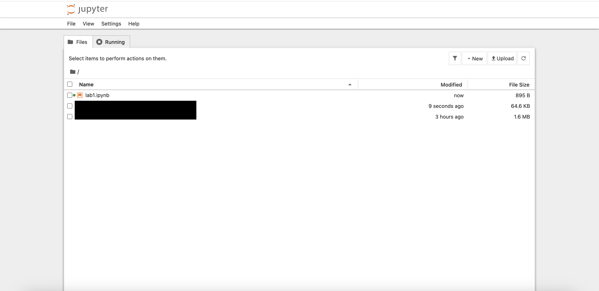
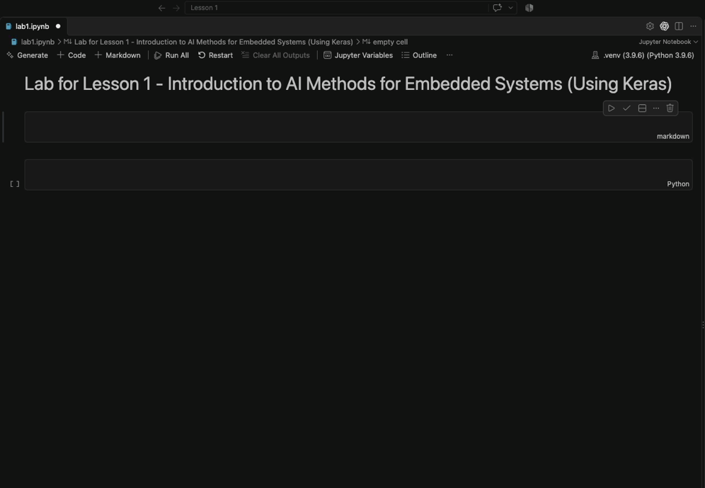
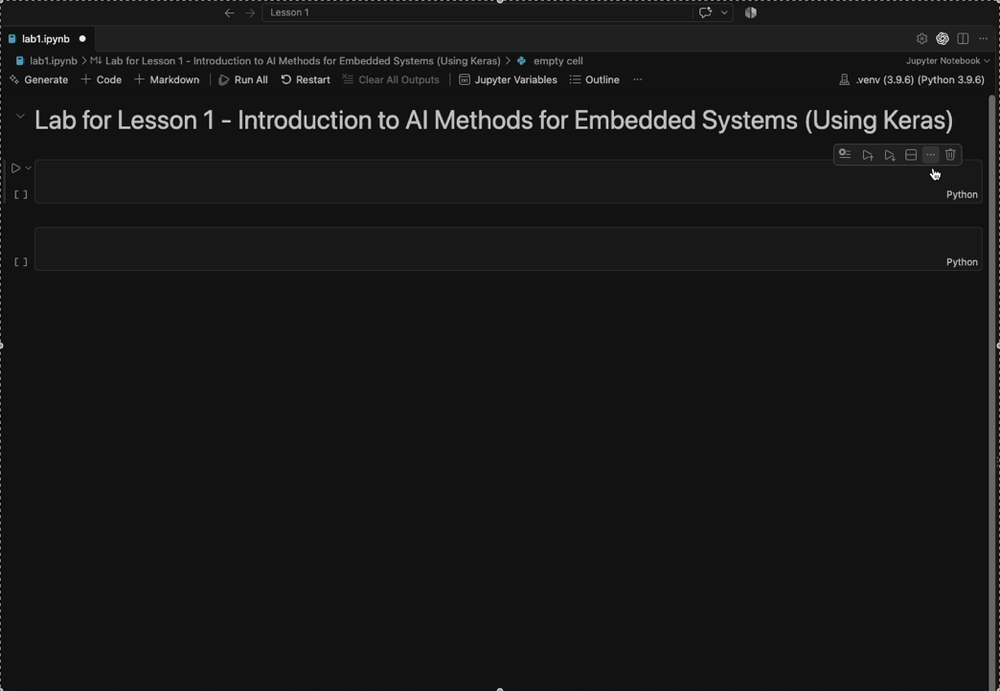
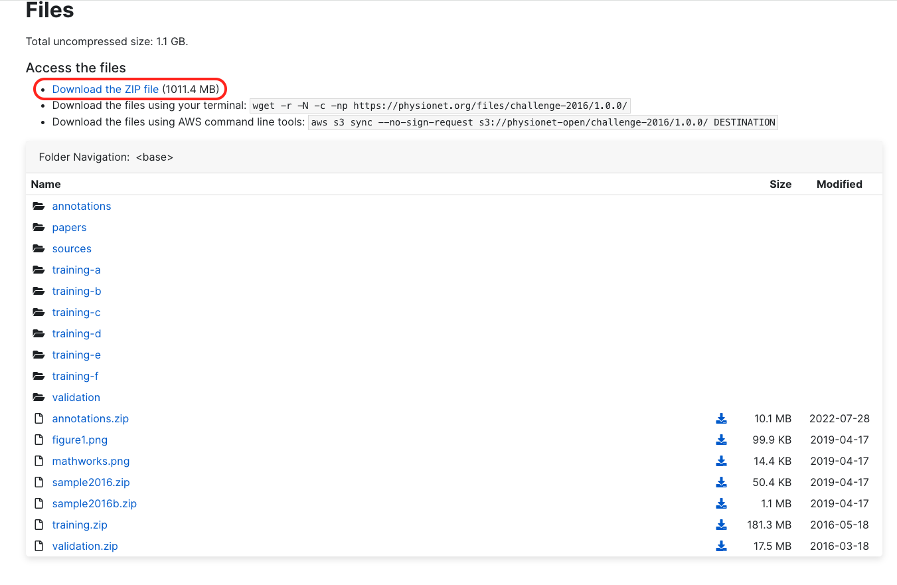
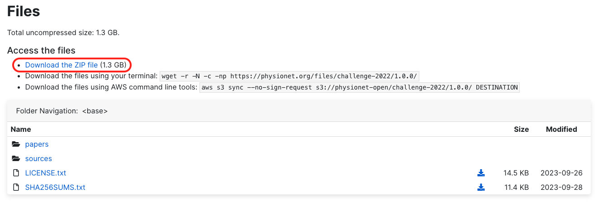

# **Laboratory 1 — Introduction to AI Methods for Embedded Systems (Using Keras)**

## **1. Laboratory Overview**

Artificial Intelligence methods are increasingly used for tasks that are difficult to solve using explicitly programmed rules. Examples include sensor interpretation, anomaly detection, image recognition, audio classification, predictive maintenance, and medical signal analysis. Such tasks, especially those who need to be performed in real time, cannot often be deployed on a general purpose computer having all the resources in the world available. These need to be deployed as embedded systems which have limited processing power, memory, storage and sometimes even limited battery life.

In this laboratory, students are introduced to neural-network development using **Keras with the TensorFlow framework used as backend**. No previous experience with TensorFlow, Keras, PyTorch, or other machine-learning frameworks is required.

The laboratory follows a progressive approach. Students first become familiar with the Keras programming model and train a small neural network for a regression problem related to sensor calibration. They then move to a more realistic embedded-AI application inspired from the functionality of a digital stethoscope: the detection of heart murmurs from heart sounds recordings.

The second part introduces Convolutional Neural Networks (CNNs) from first principles. Heart sound recordings are transformed into time-frequency representations that can be processed by a two-dimensional CNN.

The emphasis of the laboratory is not only on obtaining a working neural network, but also on understanding the complete development workflow:

**data → preprocessing → model architecture → training → evaluation → experimentation → embedded-system considerations**

Estimated completion time: **approximately 4 hours**.

## **2. Learning Objectives**

After completing this laboratory, the student should be able to:

- explain the difference between regression and classification;

- understand what samples, features, targets, training data, validation data, and test data are;

- create and configure a Python environment containing TensorFlow and Keras;

- construct a basic neural network using the Keras Sequential API;

- understand what input, hidden, and output layers are;

- train a neural network using the model.fit() Keras method;

- explain the roles of a loss function, activation function, optimizer, metric, epoch, and batch;

- evaluate a regression model using Mean Absolute Error and Mean Squared Error;

- distinguish between training performance and validation performance;

- understand the basic operating principle of a convolutional layer;

- design the architecture of a simple CNN for binary classification;

- interpret a confusion matrix and basic classification metrics;

- recognize overfitting and underfitting;

- experiment with basic neural-network hyperparameters;

- discuss why model size, preprocessing complexity, memory usage, and inference cost are relevant for embedded AI.

## **3. Prerequisites**

Students are expected to have:

- basic programming knowledge;

- basic Python syntax;

- familiarity with variables, functions, lists, arrays, loops, and conditional statements;

- basic understanding of mathematical functions.

Previous knowledge of neural networks is useful but not required.

The recorded lecture and the materials associated with it introduce the fundamental concepts required for understanding neural networks. Students interested in a deeper mathematical understanding are encouraged to also consult the additional references provided in both the lecture and in this lab.

Additional Resources :

- Melanie Mitchell - Artificial Intelligence. A guide for thinking humans

- Dive into deep learning - [<u>https://d2l.ai/index.html</u>](https://d2l.ai/index.html)

- Andrej Karpathy’s Youtube playlist Neural Networks : Zero to Hero - [<u>https://karpathy.ai/zero-to-hero.html</u>](https://karpathy.ai/zero-to-hero.html)

- The Independent Code Youtube Channel

  - Neural Network from Scratch (<https://youtu.be/pauPCy_s0Ok?si=CSDVU3Jg15860R8g>)

  - Convolutional Neural Network from Scratch (<https://youtu.be/Lakz2MoHy6o?si=70x6Wah5mLLMzwuj>)

- Harper Carroll’s 10 days of AI basics (short form) (<https://youtube.com/playlist?list=PL-ocKywdn6lHkia9UoSY709h6AG2jWKKM&si=chSDcFbPPBJPwCuc>)

- Harper Carroll’s 10 days of AI basics (long form) : (<https://youtube.com/playlist?list=PL-ocKywdn6lE9l4LIPL4gMY4nNRfjEswG&si=quZbfKk1uJl45nNO>)

- DeepBean Youtube channel : Optimization for Deep Learning (Momentum, RMSprop, AdaGrad, Adam) : (<https://youtu.be/NE88eqLngkg?si=NsO5rp3Yhho1EHCE>)

## **5. Environment Setup**

### **5.1 Creating a Python virtual environment**

Using a dedicated virtual environment prevents dependencies installed for this laboratory from interfering with other Python projects.

Create a new directory for the laboratory and open a terminal inside it.

Create the environment:

``` bash
python -m venv .venv
```

On Windows PowerShell:

``` powershell
.venv\Scripts\Activate.ps1
```

On Linux or macOS:

``` bash
source .venv/bin/activate
```

❗️Be careful what Python version you use and which are the compatible Python versions with Tensorflow. While writing this lab the latest version of tensorflow is 2.21.0 which was launched in March 2026 and the only allowed Python versions are 3.9 – 3.13. You can check the Python version support and other system requirements on the page <https://www.tensorflow.org/install> (accessed in October 2026).

Upgrade pip:

``` bash
python -m pip install --upgrade pip
```

Install the packages required throughout the laboratory:

``` bash
pip install tensorflow keras numpy matplotlib pandas scikit-learn librosa soundfile jupyter
```

Keras 3 can operate with several computational backends, including TensorFlow, JAX, and PyTorch. In this course, **TensorFlow will be used as the Keras backend** in order to maintain a common environment for all exercises. Current Keras documentation describes Keras as a multi-backend framework and allows TensorFlow to be selected explicitly.

### **5.2 Starting Jupyter**

You can either open a jupyter notebook in the standalone web interface or within an intergrated development environment (IDE).

#### **Using Jupyter Notebook interface :**

Open a terminal inside the virtual environment.

Start Jupyter Notebook with:

``` bash
jupyter notebook
```

A window as the one below illustrating a file hierarchy will be shown :



Create a new Python notebook called:

``` text
lab01_keras_introduction.ipynb
```

Open the notebook. The jupyter notebook is made out of cells. Choose between a code or a markdown cell from the dropdown menu highlighted in the image below :


#### **Using the jupyter notebook extension of the IDE (Visual Studio Code in this case) :**


Open the folder where the virtual environment was saved.

Create a new Python notebook called:

``` text
lab01_keras_introduction.ipynb
```

Open the notebook .ipynb file.

Select the virtual environment as the jupyter notebook kernel like in the video below.



The notebook is made out of cells. You can select the programming language the contents of a cell need to be interpreted as by clicking on the option on the bottom right corner and by selecting.



All exercises in this laboratory can be completed inside this notebook.

## **6. Importing the Required Libraries**

The Keras backend must be selected before importing Keras.

``` python
import os

os.environ["KERAS_BACKEND"] = "tensorflow"

import keras
from keras import layers

import tensorflow as tf
import numpy as np
import matplotlib.pyplot as plt
import pandas as pd
```

For reproducibility, initialize the random number generators:

``` python
keras.utils.set_random_seed(42)
```

Display the installed versions:

``` python
print("Keras version:", keras.__version__)
print("TensorFlow version:", tf.__version__)
```

Inspect the computational devices detected by TensorFlow:

``` python
print(tf.config.list_physical_devices())
```

A GPU is not required for the simple models developed in this laboratory. CPU execution is sufficient.

## **7. Keras Basics**

### **7.1 What is Keras?**

Keras is a high-level API for constructing and training neural networks. Rather than manually implementing operations such as gradient calculation and weight updates, developers describe the architecture of the neural network and configure how it should be trained.

A neural network in Keras is composed of **layers**.

For simple architectures in which the output of one layer becomes the input of the next layer, Keras provides the Sequential model. The official Keras documentation describes Sequential as appropriate for a plain stack of layers with one input tensor and one output tensor per layer.

The output values of a neural network are called **predictions. Prediction** is usually prefered instead of **forecast.** Forecasts are predictions of future events. The process of running a neural network in called **inference**.

**Deep learning** is an umbrella term used frequently in discussions about AI. It actually refers to a neural network whose weights are optimized using machine learning and has at least 2 hidden layers. A **hidded layer** is a layer which is neither the input layer, nor the output layer.

Consider the following small network:

``` python
model = keras.Sequential([
    keras.Input(shape=(3,)),
    layers.Dense(8, activation="relu"),
    layers.Dense(1)
])
```

Run the following commpand afterwards and analyse its output :

``` python
model.summary()
```

The model receives three numerical values as its input.

The first Dense layer contains eight artificial neurons. Each neuron computes a weighted combination of its inputs and subsequently applies the ReLU activation function.

The final layer takes the input given by the previous dense layer and its only neuron produces one numerical value which is the output of the whole neural network.

#### **Exercise 1**

Inspect the output generated by:

``` python
model.summary()
```

Answer the following questions:

1.  What is the input dimension of the model?  
    A : The input dimension is (3,) which represents a one-dimensional tensor containing three zero dimensional vectors. (scalars).

2.  How many neurons are present in the hidden layer?  
    A : 8 neurons

3.  How many outputs does the model produce?  
    A : It only produces one output.

4.  How many trainable parameters does each layer contain?  
    A : The first dense layer produces 32 trainable parameters while the second and final dense layer produces 9 trainable parameters.

5.  Why does the first dense layer have 32 trainable parameters if the input is only built from 3 scalars and the layer itself has only 8 neurons?  
    A : Each neuron computes ReLU(w1\*x1 + w2\*x2 + w3\*x3 + b), where w1/2/3 are the weights, x1/2/3 are the input scalars and b is the bias of a particular neuron.

## **8. From Model Architecture to Training**

Constructing the layers only defines the structure of the neural network. Before training, Keras must also know:

- which optimization algorithm should modify the weights;

- which loss function should quantify prediction errors;

- which additional metrics should be displayed.

For example:

``` python
model.compile(
    optimizer=keras.optimizers.Adam(learning_rate=0.001),
    loss="mean_squared_error",
    metrics=["mean_absolute_error"]
)
```

#### **Loss function**

The **loss function** expresses how incorrect the predictions of the model are. The training algorithm attempts to minimize this quantity.

#### **Optimizer**

The **optimizer** determines how model parameters are updated based on the gradients computed during training.

Adam is a commonly used gradient-based optimizer and will be used throughout this introductory laboratory. The backpropagation algorithms for computing gradients is used for computing the new weights based on the loss function value.

#### **Metric**

A **metric** is an additional quantity used for interpreting model performance. Metrics do not necessarily determine how the weights are updated.

For example, Mean Absolute Error is often easier to interpret than Mean Squared Error because it is expressed in the same unit as the predicted variable.

## **9. Important Training Terminology**

Before continuing, the following terminology should be understood.

#### **Sample**

One individual example presented to the model.

#### **Feature**

A value supplied to the neural network as an input.

#### **Target or label**

The expected output associated with a sample.

#### **Batch**

A group of samples processed before performing a model parameter update.

#### **Epoch**

One complete pass through the training dataset.

#### **Training set**

The data used for modifying the neural-network parameters.

#### **Validation set**

Data not used for updating the parameters. It is evaluated periodically during training in order to estimate how the model behaves on samples that were not used directly for optimization.

#### **Test set**

A separate dataset used to obtain the final evaluation of the trained model.

The test dataset should not be repeatedly used when deciding how the architecture should be modified. Otherwise, information from the test set indirectly influences model development.

## **10. Introducing a regression problem: Neural-Network Sensor Calibration**

Embedded systems frequently obtain physical measurements through sensors.

An ideal sensor might produce an output that is perfectly proportional to the measured physical quantity. Real sensors, however, may exhibit:

- nonlinear responses;

- manufacturing variation;

- electrical noise;

- environmental effects;

- calibration errors.

In this exercise, a hypothetical temperature sensor produces an electrical voltage. The relationship between voltage and temperature is deliberately nonlinear.

The goal of the neural network is:

**Given the measured sensor voltage, estimate the corresponding temperature in degrees Celsius.**

This is a **regression problem** because the required output is a continuous numerical value.

## **11. Generating the Sensor Dataset**

For this introductory exercise, data will be generated synthetically. This makes it possible to focus on the neural-network workflow without requiring an external dataset.

``` python
rng = np.random.default_rng(42)

n_samples = 2000

temperature_c = rng.uniform(
    low=-20.0,
    high=80.0,
    size=n_samples
)

ideal_voltage = (
    0.50
    + 0.012 * temperature_c
    + 0.00004 * temperature_c**2
)

measured_voltage = ideal_voltage + rng.normal(
    loc=0.0,
    scale=0.015,
    size=n_samples
)
# The parameter “-1” of the reshape method allows numpy to compute the dimension of that axis.
X = measured_voltage.reshape(-1, 1).astype("float32")
y = temperature_c.reshape(-1, 1).astype("float32")
```

The quadratic term introduces a small nonlinear component, while the Gaussian noise approximates measurement noise.

Visualize the generated data:

``` python
plt.scatter(
    measured_voltage,
    temperature_c,
    s=10,
    alpha=0.5
)

plt.xlabel("Sensor voltage [V]")
plt.ylabel("Temperature [°C]")
plt.title("Synthetic Temperature Sensor")
plt.show()
```

#### **Proposed Exercise :**

Examine the plot.

Answer:

1.  Which variable is the model input of the regression model? The temperature or the voltage?

2.  Is the relationship between temperature and voltage perfectly linear? Yes or no?

## **12. Splitting the Dataset**

The dataset will be divided into:

- 70% training data;

- 15% validation data;

- 15% test data.

``` python
from sklearn.model_selection import train_test_split

X_train, X_temp, y_train, y_temp = train_test_split(
    X,
    y,
    test_size=0.30,
    random_state=42
)

X_val, X_test, y_val, y_test = train_test_split(
    X_temp,
    y_temp,
    test_size=0.50,
    random_state=42
)

print("Training samples:", len(X_train))
print("Validation samples:", len(X_val))
print("Test samples:", len(X_test))
```

Verify that the three subsets contain the expected number of samples.

## **13. Input Normalization**

Neural networks commonly train more easily when numerical inputs have comparable scales.

Keras provides a preprocessing layer called Normalization.

Create the layer:

``` python
normalizer = layers.Normalization(axis=-1)
```

The layer must first learn the statistics of the training data:

``` python
normalizer.adapt(X_train)
```

Inspect its internal statistics:

``` python
print("Mean:", normalizer.mean.numpy())
print("Variance:", normalizer.variance.numpy())
```

An important rule is that normalization parameters should be determined from the **training data**, rather than from the complete dataset.

Using validation or test data when calculating preprocessing parameters would introduce information about those datasets into the training pipeline.

## **14. Constructing the Regression Network**

Create the following neural network:

``` python
regression_model = keras.Sequential([
    keras.Input(shape=(1,)),
    normalizer,

    layers.Dense(16, activation="relu"),
    layers.Dense(16, activation="relu"),

    layers.Dense(1)
])
```

Display the architecture:

``` python
regression_model.summary()
```

The network contains:

- one numerical input;

- input normalization;

- two hidden fully connected layers;

- one continuous output.

No activation function is used for the final neuron because the regression output should not be restricted to a fixed interval.

## **15. Compiling the Regression Model**

Compile the model:

``` python
regression_model.compile(
    optimizer=keras.optimizers.Adam(
        learning_rate=0.001
    ),
    loss="mean_squared_error",
    metrics=["mean_absolute_error"]
)
```

The model is trained using Mean Squared Error:

<math display="block" xmlns="http://www.w3.org/1998/Math/MathML"><semantics><mrow><mi>M</mi><mi>S</mi><mi>E</mi><mspace width="0.222em"></mspace><mo>=</mo><mspace width="0.222em"></mspace><mfrac><mn>1</mn><mi>N</mi></mfrac><munderover><mo>∑</mo><mrow><mi>i</mi><mspace width="0.222em"></mspace><mo>=</mo><mspace width="0.222em"></mspace><mn>1</mn></mrow><mi>N</mi></munderover><msup><mrow><mo stretchy="true" form="prefix">(</mo><msub><mi>y</mi><mi>i</mi></msub><mspace width="0.222em"></mspace><mo>−</mo><mspace width="0.222em"></mspace><msub><mi>ŷ</mi><mi>i</mi></msub><mo stretchy="true" form="postfix">)</mo></mrow><mn>2</mn></msup></mrow><annotation encoding="application/x-tex">MSE\  = \ \frac{1}{N}\sum_{i\  = \ 1}^{N}{(y_{i}\  - \ ŷ_{i})}^{2}</annotation></semantics></math>

The additional Mean Absolute Error (MAE) metric is:

<math display="block" xmlns="http://www.w3.org/1998/Math/MathML"><semantics><mrow><mi>M</mi><mi>A</mi><mi>E</mi><mspace width="0.222em"></mspace><mo>=</mo><mspace width="0.222em"></mspace><mfrac><mn>1</mn><mi>N</mi></mfrac><munderover><mo>∑</mo><mrow><mi>i</mi><mspace width="0.222em"></mspace><mo>=</mo><mspace width="0.222em"></mspace><mn>1</mn></mrow><mi>N</mi></munderover><mrow><mo stretchy="true" form="prefix">|</mo><msub><mi>y</mi><mi>i</mi></msub><mspace width="0.222em"></mspace><mo>−</mo><mspace width="0.222em"></mspace><msub><mi>ŷ</mi><mi>i</mi></msub><mo stretchy="true" form="postfix">|</mo></mrow></mrow><annotation encoding="application/x-tex">MAE\  = \ \frac{1}{N}\sum_{i\  = \ 1}^{N}{|y_{i}\  - \ ŷ_{i}|}</annotation></semantics></math>

For this problem, MAE has an intuitive interpretation because it is expressed in degrees Celsius.

## **16. Training the Model**

Create an early-stopping callback:

``` python
early_stopping = keras.callbacks.EarlyStopping(
    monitor="val_loss",
    patience=15,
    restore_best_weights=True
)
```

Train the model (it will take awhile) :

``` python
history = regression_model.fit(
    X_train,
    y_train,
    validation_data=(X_val, y_val),
    epochs=200,
    batch_size=32,
    callbacks=[early_stopping],
    verbose=0
)
```

Print the number of completed epochs:

``` python
print(
    "Training stopped after",
    len(history.history["loss"]),
    "epochs"
)
```

Early stopping terminates training when validation performance stops improving for a specified number of epochs.

## **17. Visualizing the Training Process**

Plot the training and validation losses:

``` python
plt.plot(
    history.history["loss"],
    label="Training loss"
)

plt.plot(
    history.history["val_loss"],
    label="Validation loss"
)

plt.xlabel("Epoch")
plt.ylabel("Mean Squared Error")
plt.title("Regression Model Training")
plt.legend()
plt.show()
```

#### **Proposeed Exercises :**

Examine the curves and answer:

1.  Does the training loss decrease? – **Open question. To be left here**

2.  Does the validation loss decrease? – **Open question. To be left here**

3.  At approximately which epoch does the validation loss stop improving? - **Open question. To be left here**

4.  What might it mean if training loss continued to decrease while validation loss increased?  
    A. The model may be overfitting, improving on the training data while generalizing less effectively to unseen data.  
    B. The model may be underfitting, failing to learn patterns in the training data.  
    C. The model may be generalizing better, because decreasing training loss guarantees improved validation performance.  
    **Correct answer: A.**

5.  Why is validation performance generally more informative than training performance when comparing different architectures?  
    A. It measures how quickly each architecture learns during training.  
    B. It indicates how well each architecture generalizes to data not used to update its weights.  
    C. It guarantees which architecture will perform best on every future dataset.  
    **Correct answer: B.**

## **18. Evaluating the Regression Model**

Evaluate the final model using the test dataset:

``` python
test_mse, test_mae = regression_model.evaluate(
    X_test,
    y_test,
    verbose=0
)

print("Test MSE:", test_mse)
print("Test MAE:", test_mae, "°C")
```

The test MAE represents the average absolute prediction error measured in degrees Celsius.

Generate predictions:

``` python
predictions = regression_model.predict(
    X_test,
    verbose=0
).flatten()

true_values = y_test.flatten()
```

Visualize predictions against the true temperatures:

``` python
plt.scatter(
    true_values,
    predictions,
    alpha=0.5
)

minimum = min(
    true_values.min(),
    predictions.min()
)

maximum = max(
    true_values.max(),
    predictions.max()
)

plt.plot(
    [minimum, maximum],
    [minimum, maximum],
    "--"
)

plt.xlabel("True temperature [°C]")
plt.ylabel("Predicted temperature [°C]")
plt.title("True vs. Predicted Temperature")
plt.show()
```

Points close to the diagonal represent accurate predictions.

## **20. From Regression to Classification**

The previous network produced one continuous numerical output.

The next task formulates a different problem.

Instead of predicting a physical quantity, the system must determine which of two classes is associated with an input. This task is called **binary classification**.

The application which you will develop further is inspired from the functionality of a **digital stethoscope** to analyse audio heart sounds recordings and to predict whether the heart sounds contain so called murmurs (pathological heart sounds) or not. Therefore, the further developed neural network will be capable of predicting one of two labels for each heart sounds recording : “normal” or “murmur”.

Bear in mind that the heart sounds have low frequencies ranging approximately between 20Hz and 500Hz. Usually the cardiac murmurs have the highest frequencies.

Because both the timing and the frequency of the heart sounds are important to detect whether they contain murmus or not the analysis will be performed using a time-frequency representation. For this lab the spectrograms will be used. Therefore, instead of analysing a the samples of the audio recording files, images will be analysed. **Convolutional neural networks** are one of the main types of neural networks used for image classification.

This introduces three important changes:

1.  the output becomes categorical rather than continuous;

2.  the input becomes considerably more complex than a single numerical measurement;

3.  convolutional neural networks will be introduced.

## **21. Heart Sound Data**

For training a neural network we need data. Therefore, we are going to use two publicly available datasets conducted by PhysioNet (a global aplatform for biomedical research manged by the MIT laboratory for computational physiology). We are going to merge these two datasets.

### **21.1 PhysioNet/Computing in Cardiology Challenge 2016**

The PhysioNet/CinC Challenge 2016 (<https://physionet.org/content/challenge-2016/1.0.0>) provided a public dataset containing thousands of phonocardiogram recordings acquired under heterogeneous clinical and non-clinical conditions.

The training data is built from 6 different public datasets developed by 6 different universities and it contains around 3200 recordings, with recording durations ranging from several seconds to more than two minutes. All the recordings were resampled to 2,000 Hz and are supplied as .wav files. Noise sources include speech, breathing, stethoscope movement, and other environmental or physiological sounds.

Its principal reference labels are:

#### **Normal**

#### **Abnormal**

The *Abnormal* category represents patients with confirmed cardiac murmurs.

### **21.2 George B. Moody PhysioNet Challenge 2022**

The 2022 challenge (<https://physionet.org/content/challenge-2022/1.0.0/>) also provided a public dataset originating from the CirCor DigiScope phonocardiogram collection and contains one or more heart-sound recordings for individual patients.

The public Challenge training set contains around 5200 from around 1500 patients. The recordings were sampled at 4kHz. The dataset explicitly provides murmur-related labels:

#### **Present**

#### **Absent**

#### **Unknown**

It also contains information concerning auscultation locations and patient-level metadata.

## **22. Dataset Exploration Exercise**

No neural network should be designed before the developer understands the dataset.

Download the dataset from the PhysioNet/Computing in Cardiology Challenge 2016. You can download the ZIP file containing all the information from the bottom of the page <https://physionet.org/content/challenge-2016/1.0.0/>.



Download the dataset of the George B. Moody PhysioNet Challenge 2022. You can download the ZIP file containing all the information from the bottom of the page <https://physionet.org/content/challenge-2022/1.0.0/>.



Move the downloaded datasets in the directory where the jupyer notebook is located.

The PhysioNet/Computing in Cardiology Challenge 2016 dataset is split in 6 subdirectories (“training-a” =\> “training-f”). Each of them has a REFERENCE.csv file inside it. These .csv files link the names of the .wav audio files with the labels (label “-1” for recordings containing murmurs and label “1” for normal recordings).

The George B. Moody PhysioNet Challenge 2022 dataset contains a file named training_data.csv. It is a much more comprehensive .csv file than the ones found in the 2016 dataset.

Inspect manually first of all the excel files and some of the .wav files provided by the datasets and determine:

- the total number of recordings;

- the number of recordings associated with each class;

- recording durations;

- sampling frequencies;

- the different auscultation locations;

- whether data dataset is balanced or not (if both labels have the same number of samples or not)

- how many recordings are marked as uncertain or unsuitable.

Let’s merge the datasets and create a short dataset summary in the jupyter notebook containing:

1.  number of usable samples;

2.  number of positive and negative samples;

3.  class percentages;

We are going to use a data structure called **dataframe** implemented in the Pandas module. It is a useful data structure for manipulating large datasets.

#### **PHYSIONET 2016 DATASET MANIPULATION :**

``` python
physionet_2016_source_directory = r"<path to physionet cinc 2016 dataset>"
normal_recordings_destination_directory = r'<path to destination directory for normal recordings>'
murmur_recordings_destination_directory = r'<path to destination directory for murmur recordings>'

# Make sure the destination directories exist
os.makedirs(normal_recordings_destination_directory, exist_ok=True)
os.makedirs(murmur_recordings_destination_directory, exist_ok=True)

# TO BE RUN ONLY ONCE. TO BE COMMENTED OUT AFTERWARDS. Otherwise, it will overwrite the files in the destination directory every time.

relevant_subdirs = ["training-a", "training-b", "training-c", "training-d", "training-e", "training-f"]

for sub_dir in relevant_subdirs:
    sub_dir_path = os.path.join(physionet_2016_source_directory, sub_dir)
    reference_csv_path = os.path.join(sub_dir_path, "REFERENCE.csv")

    if os.path.isfile(reference_csv_path):
        data = pd.read_csv(reference_csv_path, header=None, names=["Recording ID", "Murmur Status"])

        for index, row in data.iterrows():
	    # Use strip() for removing any leading or trailing white space
            recording_id = str(row["Recording ID"]).strip()
            murmur_status = int(row["Murmur Status"])  # -1 for normal, 1 for murmur
            
            recording_file = f"{recording_id}.wav"
            recording_file_source_path = os.path.join(sub_dir_path, recording_file)

            if not os.path.isfile(recording_file_source_path):
                print(f"Warning: File {recording_file} not found in {sub_dir_path}. Skipping.")
                continue

            if murmur_status == -1:
                new_file_name = f"{recording_id}_normal.wav"
                recording_file_destination_path = os.path.join(normal_recordings_destination_directory, new_file_name)
            elif murmur_status == 1:
                new_file_name = f"{recording_id}_murmur.wav"
                recording_file_destination_path = os.path.join(murmur_recordings_destination_directory, new_file_name)
            else:
                continue

            # Copy and rename the file
            shutil.copy2(recording_file_source_path, recording_file_destination_path)
            print(f"Copied and renamed: {recording_file} -> {recording_file_destination_path}")

print("Processing completed.")
```

#### **PHYSIONET 2022 DATASET MANIPULATION** 

``` python
physionet_2022_source_directory = r'<path to the PhysioNet2022 Challenge Dataset>'
physionet_2022_csv_path = os.path.join(physionet_2022_source_directory, 'training_data.csv')

# TO BE RUN ONLY ONCE. TO BE COMMENTED OUT AFTERWARDS. Otherwise, it will overwrite the files in the destination directory every time.

physionet_2022_data = pd.read_csv(physionet_2022_csv_path)

for index, row in physionet_2022_data.iterrows():
    patient_id = str(row['Patient ID']).strip()
    status = str(row['Murmur']).strip()
    murmur_locations = str(row['Murmur locations']).strip() if status == "Present" else ""
    # e.g. : Murmur location = AV+MV+PV+TV
    murmur_locations_set = set(murmur_locations.split('+')) if murmur_locations else set()

    # Get all files for the patient
    patient_files = [f for f in os.listdir(physionet_2022_source_directory) if f.startswith(patient_id + "_") and f.endswith(".wav")]

    for file in patient_files:
        auscultation_location = file.split('_')[1].replace(".wav", "")
        # Ignore the patients with "Unknown" "Murmur" column status. They are considered inconclusive
        if status == "Absent":
            # splitext() returns a tuple (root, ext), so we take the first element [0] to get the root without extension
            new_file_name = f"{os.path.splitext(file)[0]}_normal.wav"
            destination_path = os.path.join(normal_recordings_destination_directory, new_file_name)
        elif status == "Present" and auscultation_location in murmur_locations_set:
            new_file_name = f"{os.path.splitext(file)[0]}_murmur.wav"
            destination_path = os.path.join(murmur_recordings_destination_directory, new_file_name)
        else:
            # Normal recording of a patient with murmurs
            new_file_name = f"{os.path.splitext(file)[0]}_normal.wav"
            destination_path = os.path.join(normal_recordings_destination_directory, new_file_name)

        # Source file path
        source_path = os.path.join(physionet_2022_source_directory, file)

        # Copy and rename the file
        shutil.copy2(source_path, destination_path)
        print(f"Copied and renamed: {file} -> {destination_path}")

print("Processing completed.")
```

#### **COUNT THE NUMBER OF .wav FILES FOR EACH CLASS :**

``` python
def count_wav_files_in_folder(folder_path, image_extensions=(".wav")):
    count = 0
    for filename in os.listdir(folder_path):
        if filename.lower().endswith(image_extensions):
            count += 1
    return count

normal_recordings_count = count_wav_files_in_folder(normal_recordings_destination_directory)
murmur_recordings_count = count_wav_files_in_folder(murmur_recordings_destination_directory)
print(f”There are {normal_recordings_count} normal recordings in the merged dataset”)
print(f”There are {murmur_recordings_count} recordings containing murmurs in the merged dataset”)
```

#### **COUNT TOTAL NUMBER OF .wav FILES :**

``` python
print(f”There are {normal_recordings_count + murmur_recordings_count} recordings in the merged dataset”)
```

#### **COUNT THE PERCENTAGE OF EACH CLASS :**

``` python
total_recordings_count = normal_recordings_count + murmur_recordings_count
normal_percentage = (normal_recordings_count / total_recordings_count) * 100
murmur_percentage = (murmur_recordings_count / total_recordings_count) * 100
print(f"Normal recordings: {normal_recordings_count} ({normal_percentage:.2f}%)")
print(f"Murmur recordings: {murmur_recordings_count} ({murmur_percentage:.2f}%)")
```

#### **EXERCICES :**

1\. Plot a bar plot for showing the number of recordings for each class using matplotlib.

## **23. Preprocessing the dataset**

A raw heart-sound recording is a one-dimensional signal x(t) where the signal amplitude varies with time.

A two-dimensional CNN, however, expects an input with two dimensions.

The heart-sound signal will therefore be converted into a **time-frequency representation**. In this case it will be a spectrogram.

A spectrogram represents:

- time along one dimension;

- frequency along another dimension;

- signal magnitude through the intensity of each element.

This transformation allows a two-dimensional convolutional neural network to learn local patterns occurring jointly in time and frequency.

First of all, since the relevant frequency range of the heart sounds is 20-500Hz and the recordings are flooded in noise, they need to be filtered. Most conventional microphones capture anyway the frequency range 20Hz-20kHz. It is unlikely that the heart sounds recordings store any information in the range 0-20Hz. Therfore, using a low-pass filter is a good enough choice.

``` python
# A Butterworth low pass filter was chosen because it behaves close to an ideal filter

def butter_low_pass(samples, sample_rate, cutoff_freq, order, outputType):
    # Normalize the cutoff frequency
    max_freq = sample_rate / 2
    cutoff_freq_norm = cutoff_freq / max_freq

    # Calculate the Butterworth filter coefficients
    b, a = signalpy.butter(order, cutoff_freq_norm, btype='low')

    # Apply the filter to the signal
    s = signalpy.lfilter(b, a, samples).astype(outputType)
    
    return s


for normal_recording in os.listdir(normal_recordings_destination_directory) :
    recording_path = os.path.join(normal_recordings_destination_directory , normal_recording)
    # The parameter sr=None ensures that the original sample rate of the audio file is preserved when loading it with librosa.
    samples , sample_rate = librosa.load(recording_path , sr=None)
    # Relevant frequency range = 20-500Hz => Cutoff frequency = 600Hz is a good choice. 
    # The order of the filter is set to 11, which does not take too much time to compute and is enough for our purposes.
    samples_filtered = butter_low_pass(samples, sample_rate, 600, 11, np.float32)
    filtered_recording_file_name = f"{os.path.splitext(normal_recording)[0]}_filtered.wav"
    filtered_recording_path = os.path.join(filtered_normal_recordings_destination_directory, filtered_recording_file_name)
    wavfile.write(filtered_recording_path, sample_rate, samples_filtered)
    
for murmur_recording in os.listdir(murmur_recordings_destination_directory) :
    recording_path = os.path.join(murmur_recordings_destination_directory, murmur_recording)
    samples, sample_rate = librosa.load(recording_path, sr=None)
    samples_filtered = butter_low_pass(samples, sample_rate, 600, 11, np.float32)
    filtered_recording_file_name = f"{os.path.splitext(murmur_recording)[0]}_filtered.wav"
    filtered_recording_path = os.path.join(filtered_murmur_recordings_destination_directory, filtered_recording_file_name)
    wavfile.write(filtered_recording_path, sample_rate, samples_filtered)
```

#### **Generate and save the spectrograms :**

``` python
def save_spectrogram(filename, output_dir):
    y, sr = librosa.load(filename, sr=None)

    n_fft = 8192  # Increase for better frequency resolution
    hop_length = 512  # Decrease for better time resolution
    win_length = 8192  # Generally the same as n_fft

    # Using the Short Time Fourier Transform to generate the spectrogram
    D = librosa.stft(y, n_fft=n_fft, hop_length=hop_length, win_length=win_length)
    
    S = np.abs(D)

    S_dB = librosa.amplitude_to_db(S, ref=np.max)
    
    plt.figure(figsize=(600, 400, “px”))
    librosa.display.specshow(S_dB, sr=sr, x_axis='time', y_axis='linear')
    plt.colorbar(format='%+2.0f dB')
    plt.title('Spectrogram')
    plt.tight_layout()
    plt.ylim(0, 1000) # Visible frequency range 0-1000Hz
    
    basename = os.path.basename(filename)
    base_filename = os.path.splitext(basename)[0]
    output_filename = os.path.join(output_dir, base_filename + "_spectrogram.png")
    
    plt.savefig(output_filename)
    plt.close()
normal_spectrograms_dest_dir = r'<path to Normal spectrograms destination directory>'
murmur_spectrograms_dest_dir = r'<path to Murmur spectrograms destination directory>'

os.makedirs(normal_spectrograms_dest_dir, exist_ok=True)
os.makedirs(murmur_spectrograms_dest_dir, exist_ok=True)

# Move the filtered recordings into batches of 300 files.
# Only loose WAV files are included, so rerunning this cell skips existing batches.
def split_filtered_recordings_into_batches(recordings_directory, batch_size=300):
    recordings = sorted(
        recording
        for recording in os.listdir(recordings_directory)
        if recording.lower().endswith('.wav')
        and os.path.isfile(os.path.join(recordings_directory, recording))
    )

    # Equivalent to :
    # recordings = []

    # for recording in os.listdir(recordings_directory):
    #     recording_path = os.path.join(recordings_directory, recording)
    #     if recording.lower().endswith('.wav') and os.path.isfile(recording_path):
    #         recordings.append(recording)

    # recordings.sort()

    batch_directories = [
        os.path.join(recordings_directory, f'Batch{batch_number}')
        for batch_number in range(1, (len(recordings) + batch_size - 1) // batch_size + 1)
    ]
    # Avoid mixing new recordings into an existing batch or overwriting files.
    for batch_directory in batch_directories:
        if os.path.exists(batch_directory):
            raise FileExistsError(f'Batch folder already exists: {batch_directory}')

    for start, batch_directory in zip(range(0, len(recordings), batch_size), batch_directories):
        os.makedirs(batch_directory)
        for recording in recordings[start:start + batch_size]:
            #os.rename() moves the files in this case
            os.rename(
                os.path.join(recordings_directory, recording),
                os.path.join(batch_directory, recording),
            )


split_filtered_recordings_into_batches(filtered_normal_recordings_destination_directory)
split_filtered_recordings_into_batches(filtered_murmur_recordings_destination_directory)

# Generate spectrograms for one batch at a time to limit memory usage.
# Replace <add batch folder name> in both paths for the selected class, then
# uncomment its loop. Comment the loop out again after generating that batch.

# for normal_recording in os.listdir(os.path.join(filtered_normal_recordings_destination_directory, '<add batch folder name>')):
#     recording_path = os.path.join(filtered_normal_recordings_destination_directory, '<add batch folder name>', normal_recording)
#     save_spectrogram(recording_path, normal_spectrograms_dest_dir)

# for murmur_recording in os.listdir(os.path.join(filtered_murmur_recordings_destination_directory, '<add batch folder name>')):
#     recording_path = os.path.join(filtered_murmur_recordings_destination_directory, '<add batch folder name>', murmur_recording)
#     save_spectrogram(recording_path, murmur_spectrograms_dest_dir)
```

The spectrogram images also contain the time, frequency and magnitude axis. Even though it might not seem important to keep the axis it is better not to crop them out because the recordings have different lengths, but the images have the same 600x400 px dimension. Because of that, a murmur spike showing on the spectrogram might take more space in an image of a short recording rather than inside an image of a long recording. By keeping them, especially the time axis, the model can potentially learn how to make correlate the dimension of the spikes with the length of the whole recording. At the same time, if many short or long recordings happen to be aggregated in a single class, then the model might learn the correlation between the length of the recording and the label. However, we will not tackle this topic right now.

Now you have created all of the spectrograms. The next step is to prepare the data pipeline for training the neural network.

#### **PROPOSED EXERCICE :**

1\. Try filtering a recording using different cutoff frequencies and generate the spectrogram afterwards. What does it look like? Which is the difference between them?  
Hint : You can modify the save_spectrogram() method for just plotting the image below the cell. Adjust the Y axis limit of the plot according to the cutoff frequency as well.

## **24. Creating the data pipeline for training the neural network**

The dataset needs to be split for training, validation and testing. We will use 15% of the whole dataset for testing and then 12.5% of the remaining dataset for validation. Therefore the dataset split is going to be : 74.375% for training, 10.625% for validation and 15% for testing.

I suggest keeping the existing directories containing the spectrograms untouched as a backup. Create a new directory for training and validation data and another one for testing data. Inside each one create a new directory for normal spectrograms and another one for spectrograms of the recordings containing murmurs. Copy the “Normal” subdirectory of the initial spectrograms directory inside the “Normal” subdirectory of the new training/validation directory. Do the same for the “Murmur” folder. Do not copy anything yet in the folder for the testing data. Run the following code then :

``` python
test_normal_spectrograms_dest_dir = r'<path to Testing Normal spectrograms destination directory>'
test_murmur_spectrograms_dest_dir = r'<path to Testing Murmur spectrograms destination directory>'
train_val_normal_spectrograms_dest_dir = r'<path to Training/Validation Normal spectrograms destination directory>'
train_val_murmur_spectrograms_dest_dir = r'<path to Training/Validation Murmur spectrograms destination directory>'

# TO BE RUN ONLY ONCE. TO BE COMMENTED OUT AFTERWARDS

percentage_of_img_to_move = 0.15
normal_spectrograms = [f for f in os.listdir(train_val_normal_spectrograms_dest_dir) if f.endswith(".png")]
num_of_normal_spectrograms_to_move = int(len(normal_spectrograms)*percentage_of_img_to_move)
normal_spectrograms_to_move = random.sample(normal_spectrograms, num_of_normal_spectrograms_to_move)
	
for normal_spectrogam in normal_spectrograms_to_move:
    source_path = os.path.join(train_val_normal_spectrograms_dest_dir, normal_spectrogam)
    destination_path = os.path.join(test_normal_spectrograms_dest_dir, normal_spectrogam)
    shutil.move(source_path, destination_path)
    print(f"Moved: {normal_spectrogam} -> {destination_path}")


murmur_spectrograms = [f for f in os.listdir(train_val_murmur_spectrograms_dest_dir) if f.endswith(".png")]
num_of_murmur_spectrograms_to_move = int(len(murmur_spectrograms)*percentage_of_img_to_move)
murmur_spectrograms_to_move = random.sample(murmur_spectrograms, num_of_murmur_spectrograms_to_move)

for murmur_spectrogam in murmur_spectrograms_to_move:
    source_path = os.path.join(train_val_murmur_spectrograms_dest_dir, murmur_spectrogam)
    destination_path = os.path.join(test_murmur_spectrograms_dest_dir, murmur_spectrogam)
    shutil.move(source_path, destination_path)
    print(f"Moved: {murmur_spectrogam} -> {destination_path}")
```

Now a tf.data.Dataset object is going to be creating using the data of the training/validation directories.

``` python
train_val_spectrograms_dest_dir = r’<path to the training/validation folder – parent folder of the Normal/Murmur folders>’

heart_sound_recordings_spectrograms_dataset = tf.keras.utils.image_dataset_from_directory(
    train_val_spectrograms_dest_dir,
    labels='inferred',
    label_mode='binary',  # For binary classification
    batch_size=32,
    image_size=(600, 400),  # The chosen size of the spectrograms images
    shuffle=True,
    seed=123
)

class_names = heart_sound_recordings_spectrograms_dataset.class_names

print("Class mapping:", {i: class_names[i] for i in range(len(class_names))})

for images, labels in heart_sound_recordings_spectrograms_dataset.take(1):  # Take one batch only
    plt.figure(figsize=(12, 12))
    for i in range(9):  # Show the first 9 images
        plt.subplot(3, 3, i + 1)
        plt.imshow(images[i].numpy().astype("uint8"))  # Convert tensor to image format
        plt.title(f"Label: {class_names[labels[i].numpy().argmax()]}")  # Display the class index
        plt.axis("off")
    plt.show()


training_dataset_size = int(0.875*len(heart_sound_recordings_spectrograms_dataset))
validation_dataset_size = int(0.125*len(heart_sound_recordings_spectrograms_dataset))

training_dataset = heart_sound_recordings_spectrograms_dataset.take(training_dataset_size)
validation_dataset = heart_sound_recordings_spectrograms_dataset.skip(training_dataset_size).take(validation_dataset_size)


# Optimize datasets for performance

training_dataset = training_dataset.cache()
validation_dataset = validation_dataset.cache()
training_dataset = training_dataset.prefetch(tf.data.AUTOTUNE)
validation_dataset = validation_dataset.prefetch(tf.data.AUTOTUNE)
```

## **25. Introduction to Convolutional Neural Networks**

A fully connected Dense layer connects every input element to every neuron.

This rapidly becomes inefficient for image-like inputs.

A convolutional layer instead uses small learnable filters that are moved across the input.

For a spectrogram, the filters can detect local time-frequency structures.

Early convolutional layers may respond to relatively simple local patterns, while subsequent layers can combine them into increasingly complex representations.

The main layers which are going to be used are:

- **Conv2D**  
  Applies learnable two-dimensional filters to the input.  
  Important parameters include:

  - number of filters;

  - kernel size;

  - activation function.

- **MaxPooling2D**  
  Reduces the spatial dimensions of intermediate feature maps.  
  Pooling can reduce:

  - memory consumption;

  - computational requirements;

  - the number of values processed by subsequent layers.

- **Flatten**  
  Transforms multidimensional feature maps into a one-dimensional vector.

- **Dense**  
  Performs fully connected processing after the convolutional feature-extraction stages.

<!-- -->

- **Dropout**  
  Randomly disables a proportion of activations during training and can help reduce overfitting.

## **26. Training the CNN**

The objective of this exercise is to build a neural network that processes a heart-sound spectrogram and outputs a binary classification.

The sigmoid function maps the output to a value between zero and one.

``` python
input = tf.keras.Input(shape=(400,600,3))
x = tf.keras.layers.Conv2D(96, (3,3), activation='relu')(x)
x = tf.keras.layers.MaxPooling2D((2, 2))(x)
x = tf.keras.layers.Conv2D(32, (5,5), activation='relu')(x)
x = tf.keras.layers.MaxPooling2D((2, 2))(x)
x = tf.keras.layers.Flatten()(x)
x = tf.keras.layers.Dense(64, activation='relu')(x)
x = tf.keras.layers.Dropout(0.4)(x)
output = tf.keras.layers.Dense(1, activation='sigmoid')(x)

CNN_model = tf.keras.Model(inputs=input, outputs=output)
CNN_model.compile(optimizer='adam', loss='binary_crossentropy', metrics=['accuracy', tf.keras.metrics.Recall()])
```

Inspect the architecture of the neural network by running in a sepparate cell :

``` python
CNN_model.summary()
```

Train the model (it will probably take couple of hours) :

``` python
CNN_model_history = CNN_model.fit(training_dataset, epochs=10, validation_data = validation_dataset)
```

Evaluate the training metrics :

``` python
def plot_training_history(history):
    epochs = range(1, len(history.history['accuracy']) + 1)

    # Plot Accuracy
    plt.figure(figsize=(12, 5))
    plt.subplot(1, 2, 1)
    plt.plot(epochs, history.history['accuracy'], 'b', label='Training Accuracy')
    plt.plot(epochs, history.history['val_accuracy'], 'r', label='Validation Accuracy')
    plt.title('Training and Validation Accuracy')
    plt.xlabel('Epochs')
    plt.ylabel('Accuracy')
    plt.legend()

    # Plot Recall
    plt.subplot(1, 2, 2)
    plt.plot(epochs, history.history['recall'], 'b', label='Training Recall')
    plt.plot(epochs, history.history['val_recall'], 'r', label='Validation Recall')
    plt.title('Training and Validation Recall')
    plt.xlabel('Epochs')
    plt.ylabel('Recall')
    plt.legend()

    plt.show()

plot_training_history(CNN_model_history)
```

#### **Possible underfitting**

A model may be underfitting when:

- training performance is poor;

- validation performance is also poor;

- the architecture may not contain sufficient capacity to learn the relevant patterns.

#### **Possible overfitting**

A model may be overfitting when:

- training performance continues improving;

- validation performance stops improving or deteriorates;

- the difference between training and validation performance becomes large.

Potential responses to overfitting include:

- reducing model complexity;

- using Dropout;

- using appropriate regularization;

- obtaining more training data;

- applying justified data augmentation;

- using early stopping.

## **27. Evaluating the CNN on the testing dataset**

The first step is to compute the basic metrics : loss and the other metrics mentioned when the model was compiled (accuracy and recall in our case).

! Because no split threshold was mentioned for the recall metric when the model was compiled, the 0.5 default threshold is used by the evaluate() method.  
! Accuracy measures how often predictions equal labels. The accuracy metric in this case is not ideal because it checks whether the predicted scores are identical to 0 or 1. Therefore, a 0.9 prediction score will not be counted as equal to 1. The BinaryAccuracy metric would have been more suitable.

``` python
test_loss, test_accuracy, test_recall = CNN_model.evaluate(testing_dataset)
print(f"Test Loss: {test_loss:.4f}")
print(f"Test Accuracy: {test_accuracy:.4f}")
print(f"Test recall: {test_recall:.4f}")
```

However, these metrics are usually not sufficient for analysing thoroughly the neural network performances. Binary classification predicitons can be split in 4 categories : true positive, false positive, true negative, false negative. This representation helps understanding where the neural network does not work well. These categories are often grouped in a confusion matrix. Based on these 4 groups of results there are 3 main metrics which offer an even better overview of the performances of the neural network. These metrics form the classification report. The metrics are the following :

- Precision = TP/(TP + FP)  
  It shows how many samples are actually positive compared to all of the ones that were predicted as positive.

- Recall (sensitivity) = TP/(TP+FN)  
  It shows how many positive samples the model predicted correctly of all the actually positive samples

- F1-Score = 2 \* (Precision \* Recall) / (Precision + Recall) = 2\*TP/(2\*TP + FP + FN)  
  It is the harmonic mean of precision and recall, giving a high score only when both are high

You can find more metrics and their meaning on <https://scikit-learn.org/stable/api/sklearn.metrics.html>.

Predict each sample individually :

``` python
testing_dataset = testing_dataset.unbatch() #Comment out if running this cell multiple times
y_true, y_pred = [], []
for images, labels in testing_dataset:
    predictions = heart_sounds_recordings_resnet50_model.predict(tf.expand_dims(images, axis=0))
    predicted_class = predictions[0][0]
    true_class = labels.numpy()
    y_pred.append(predicted_class)
    y_true.append(true_class)

y_true = np.array(y_true)
y_pred = np.array(y_pred)
```

The predicted scores are floating point numbers between 0 and 1. Therefore we need to split them using a threshold for obtaining the binary classification. Let’s first use the threshold 0.5.

``` python
y_pred_copy = y_pred
y_pred_copy = [1 if prediction > 0.54 else 0 for prediction in y_pred_copy]
```

Print the split predictions :

``` python
print(y_pred_copy)
```

Create the confusion matrix, save it as a .png file and save the classification report as a text file :

``` python
conf_matrix = confusion_matrix(y_true, y_pred_copy)

# Display the confusion matrix
plt.figure(figsize=(10, 8))
sns.heatmap(conf_matrix, annot=True, fmt="d", cmap="Blues")
plt.xlabel("Predicted Label")
plt.ylabel("True Label")
plt.title("Confusion Matrix")
plt.show()
plt.savefig("CNN_confusion_matrix.png", dpi=300)

# Classification report
classification_report_str = classification_report(y_true, y_pred_copy, target_names=class_names)
print("Classification Report:\n", classification_report_str)
with open("CNN_classification_report.txt", "w") as file:
    file.write(classification_report_str)
```

Furthermore, a sigmoid output should not automatically be interpreted as a clinically validated probability of disease. Calibration and clinical validation are separate issues.

#### **PROPOSED EXERCISES :**

1\. Choose different split thresholds, compute the confusion matrices and the classification reports and analyse them.  
The value 0.5 is a conventional initial threshold, but it is not necessarily the optimal threshold for every application.

2\. Can two models have similar accuracy but considerably different recall?

3\. Why can accuracy become misleading when the dataset is strongly imbalanced?

4\. Let’s assume that positive means abnormal and negative means normal. In the case of heart murmur detection and medical predictive diagnostics in general, what is more preferable? Low false positive or low false negative predictions?

5\. Recall or precision directly measures how many pathological cases the model detects? If minimizing missed cases is the priority, would you prioritize high recall or high precision? Explain using their formulas.

6\. Let’s assume that a model predicts “normal” for everyone and the dataset contains 950 normal cases and 50 pathological cases. Calculate its accuracy and recall. Does its high accuracy make it suitable for detecting pathological cases?

## **33. Embedded-AI Considerations**

A neural network intended for embedded deployment should not be evaluated only according to predictive performance.

A large model may obtain slightly better accuracy on a workstation while being unsuitable for the intended target hardware.

Consider the following properties.

### **33.1 Number of parameters**

Every stored parameter consumes memory.

The number of parameters can be obtained using:

``` python
model.count_params()
```

### **33.2 Model size**

Model parameters and intermediate activations require memory.

Embedded platforms may have substantially less RAM and storage than development computers.

### **33.3 Inference time**

A model that produces a correct prediction but requires an unacceptable amount of time may not satisfy the requirements of a real-time or interactive embedded application.

### **33.4 Preprocessing cost**

Inference is not the only computational operation.

For the digital-stethoscope example, the device may also need to:

- acquire audio;

- resample the signal;

- normalize it;

- calculate a spectrogram;

- prepare the input tensor.

Preprocessing should therefore be treated as part of the complete inference pipeline.

### **33.5 Fixed input dimensions**

A model with clearly defined and fixed tensor dimensions is generally easier to reason about when targeting constrained hardware.

### **33.6 Architecture complexity**

A simple architecture based on common operations is usually preferable during early embedded-AI development.

Complex or uncommon operations may be more difficult to optimize, convert, verify, or generate code for.

### **33.7 Numerical representation**

Desktop training commonly uses floating-point arithmetic. Embedded deployment may later motivate techniques such as reduced-precision computation or quantization.

These transformations can reduce memory and computation requirements but may alter numerical results and model performance.

## **34. Exercise 12 — Embedded Deployment Analysis**

For your CNN, report:

``` text
Input tensor dimensions:
Number of trainable parameters:
Number of convolutional layers:
Number of Dense layers:
Model file size:
```

Then answer:

1.  Which layer contains the largest number of parameters?

2.  Could the architecture be made smaller without significantly changing performance?

3.  Which parts of the signal-processing pipeline must execute before CNN inference?

4.  Would increasing the spectrogram dimensions increase computational requirements?

5.  Why might an embedded deployment favor a smaller model even when a larger model produces slightly better validation results?

6.  Which model characteristics should be documented before attempting conversion or code generation for an embedded target?

## **35. Final Comparison: Regression and Classification**

Complete the following table.

| **Property**         | **Sensor Calibration** | **Heart-Sound Classification**   |
|----------------------|------------------------|----------------------------------|
| Problem type         | Regression             | Binary classification            |
| Input                | Sensor voltage         | Heart-sound spectrogram          |
| Input dimensionality | 1D feature vector      | 2D time-frequency representation |
| Output               | Temperature            | Murmur class                     |
| Final layer          | One linear neuron      | One sigmoid neuron               |
| Typical loss         | Mean Squared Error     | Binary Cross-Entropy             |
| Example metric       | MAE                    | Precision / Recall / F1          |
| Main network type    | Dense neural network   | Convolutional neural network     |

## **36. Final Questions**

Answer the following questions in your laboratory report.

1.  What is the difference between regression and classification?

2.  What is the purpose of a loss function?

3.  What is the purpose of an optimizer?

4.  What is the difference between an epoch and a batch?

5.  Why should training, validation, and test datasets be separated?

6.  Why is normalization useful?

7.  Why is a CNN appropriate for spectrogram processing?

8.  Why must multiple recordings from the same patient remain within the same dataset partition?

9.  Why is accuracy alone insufficient for many binary classification problems?

10. How can the classification threshold influence precision and recall?

11. What is overfitting?

12. Why does neural-network complexity matter for embedded systems?

13. Why should preprocessing be considered when evaluating the computational requirements of embedded AI?

14. What information would be required before deciding whether the trained CNN can execute on a specific embedded processor?

## **37. Expected Deliverables**

At the end of the laboratory, submit:

1.  the completed Jupyter notebook;

2.  regression training and validation curves;

3.  regression test MAE;

4.  a brief comparison between the original and modified regression models;

5.  dataset exploration results;

6.  the architecture summary of the CNN;

7.  CNN training and validation curves;

8.  the final confusion matrix;

9.  accuracy, precision, recall, and F1-score;

10. classification-threshold comparison;

11. comparison between two CNN configurations;

12. answers to the embedded-AI questions.

## **38. Key Takeaways**

This laboratory introduced the complete basic workflow required for neural-network development using Keras.

A neural-network project does not begin with selecting layers. It begins with understanding the problem and the available data.

Regression and classification require different output interpretations, loss functions, and evaluation methods.

Keras separates model construction, training configuration, training, prediction, and evaluation through a relatively compact API.

Convolutional neural networks provide a practical method for extracting patterns from two-dimensional representations such as spectrograms.

Finally, a model intended for embedded use cannot be selected exclusively according to predictive performance. Model complexity, memory requirements, preprocessing, inference latency, numerical representation, and deployment constraints must also be considered.

These considerations will become increasingly important in subsequent laboratories, where trained neural networks will be considered from the perspective of safety-critical and embedded implementation.
